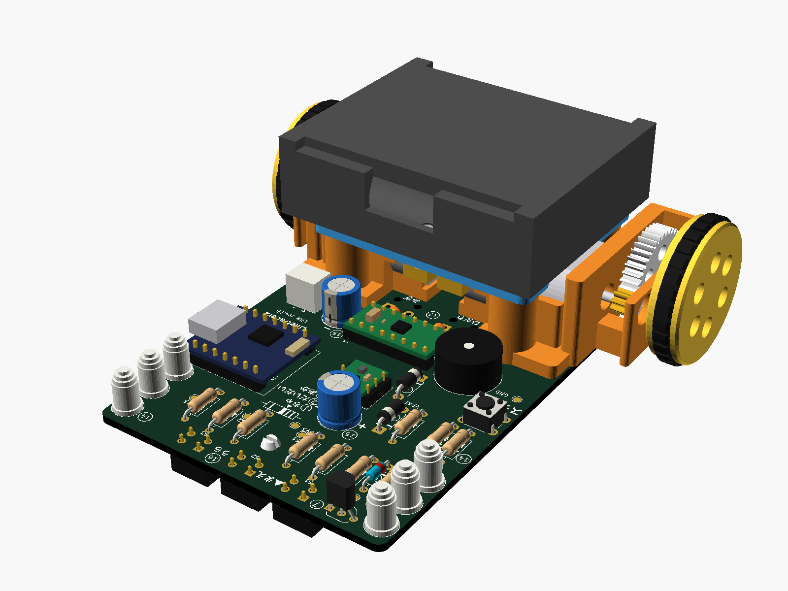
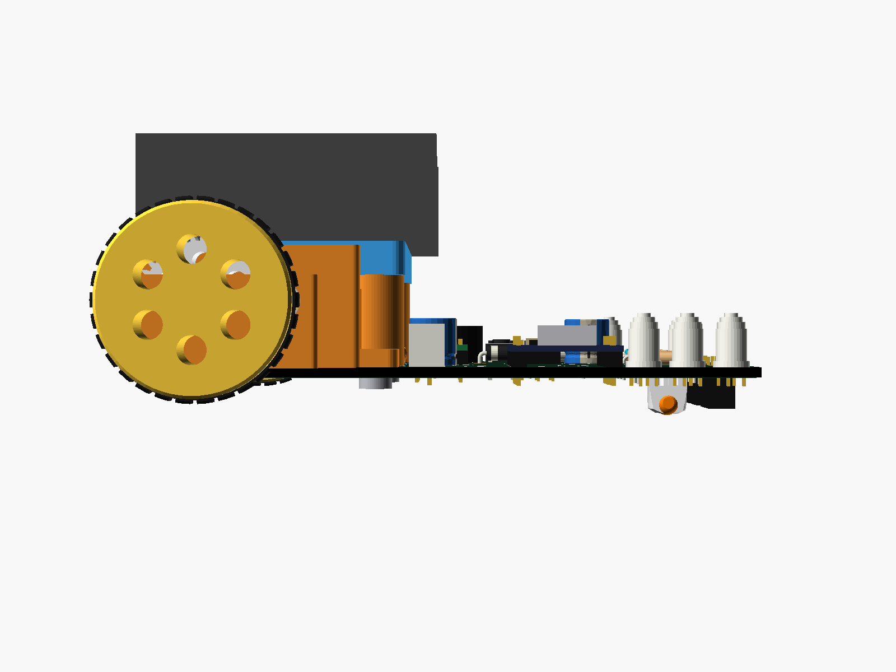
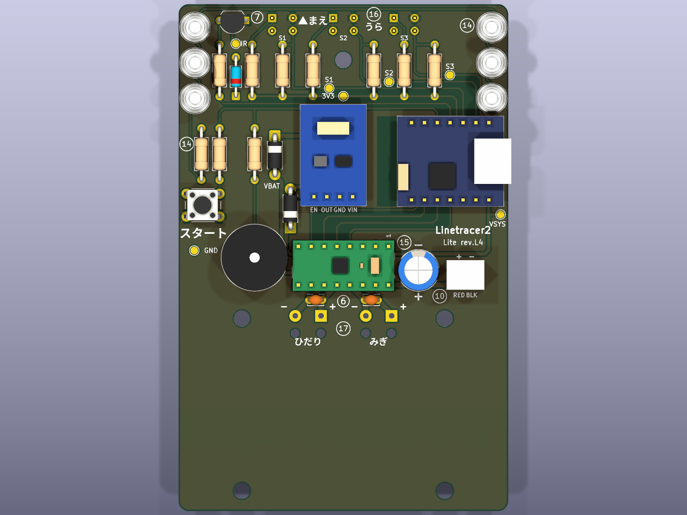
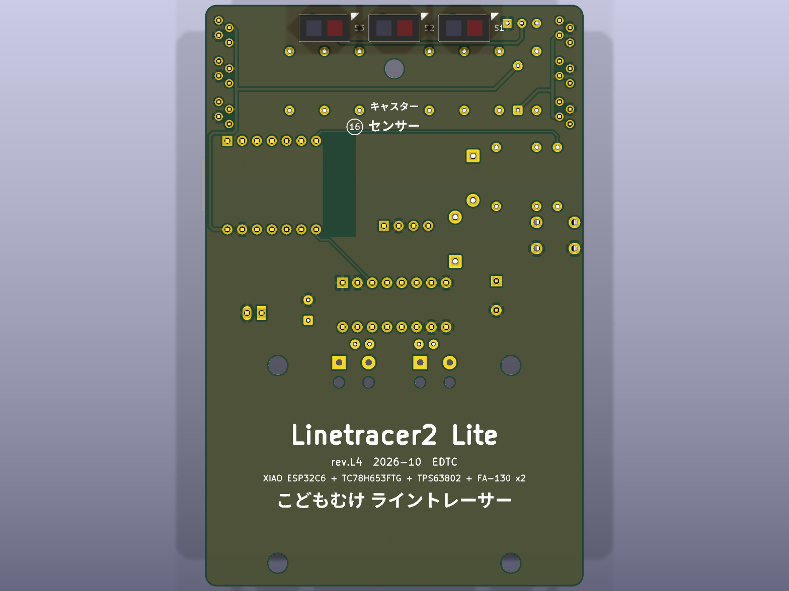
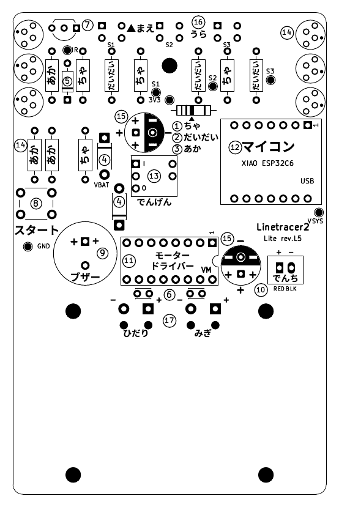
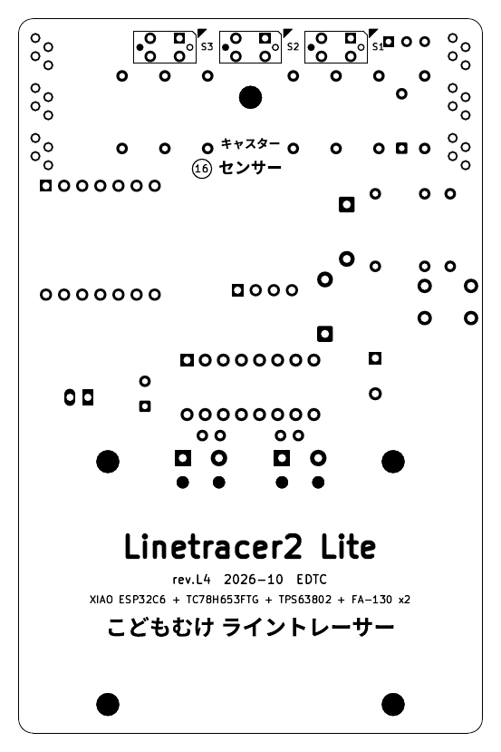
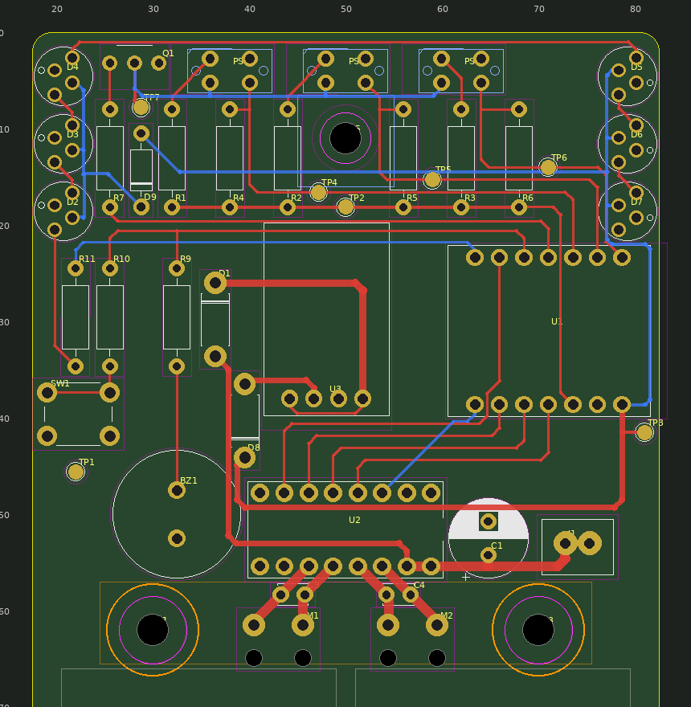
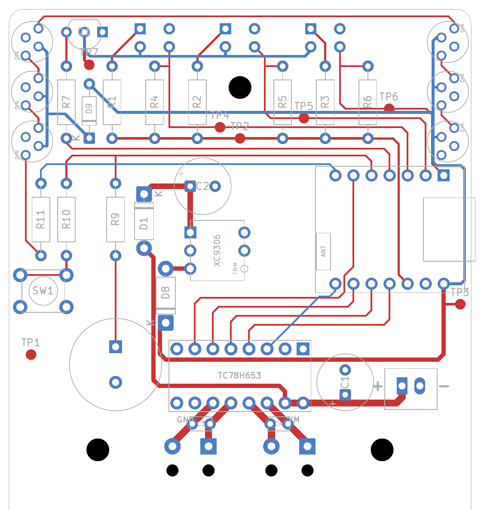
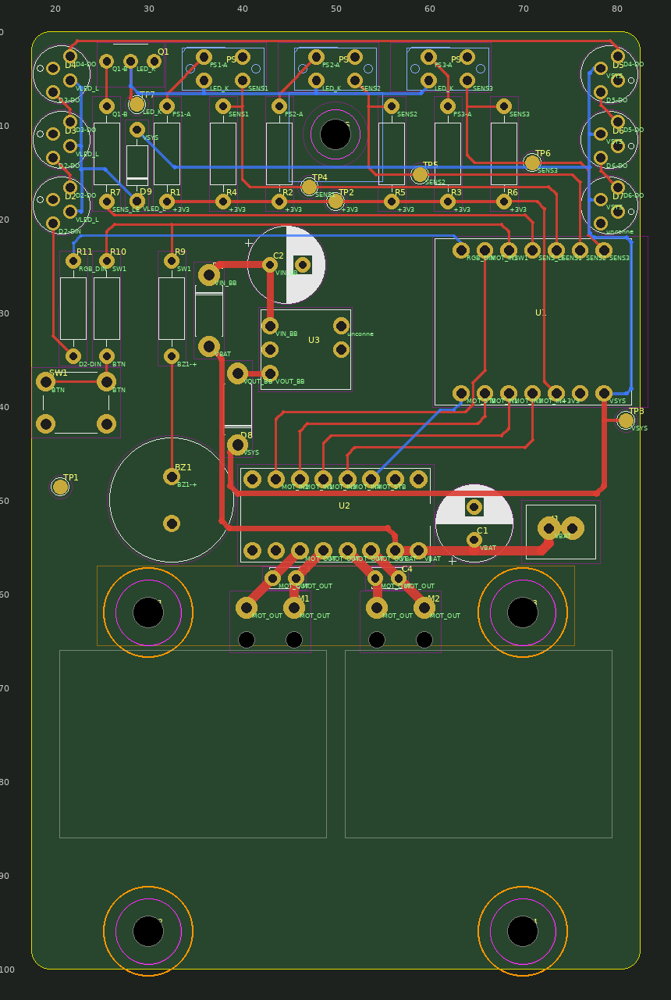
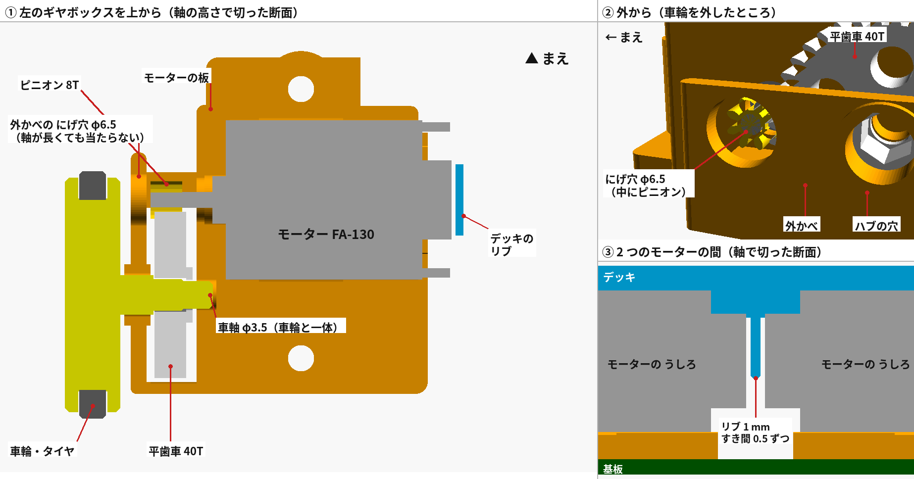

# Linetracer2 — 子ども向け教材ライントレーサー（Lite rev.L5）

> 最終更新: 2026-11-19（**Lite に一本化**。以前の「標準版 rev.A1」（Raspberry Pi Pico ＋ LBR-123F ×6）は削除した。git の履歴（コミット `3216870` まで）に残っている）
> 基板は **rev.L5**（2026-11-19: **回路を全部見直した**（§0）。車輪を止めたときにモータードライバの定格 2.0 A を超えないようにソフトでモーターを平均 1.6 V までに、売っていない昇降圧モジュール AE-TPS63802 を **AE-XC9306-5V0** に（向きをまちがえられない）、電池のばねが一瞬離れても XIAO が落ちないように **C2 470 µF**。1 台 約 ¥171 安く）。その前の rev.L4（2026-10-30）はモーターに力がかかると XIAO が落ちる問題を 5 V 昇降圧モジュールで直した版（§0b）。**未製造・未試作**。
> **KiCad のファイル（回路図・基板・Gerber・PDF・絵）、手順の絵、ロボット全体の 3D と干渉チェックは rev.L5 で作り直した**（KiCad 10.0.8、ERC 0・DRC 0（警告も 0）・未接続 0・回路図との不一致 0、干渉なし、2026-11-19）。
> マイコン **Seeed Studio XIAO ESP32C6**（ピンヘッダで付ける）、センサー **LBR-127HLD ×3**、モータードライバー **TC78H653FTG**（秋月モジュール）、**130 モーター ×2** と 3D プリントのギヤボックス（1 段 5:1）、**ブザー**、**フルカラー LED 6 こ**、**テストパッド**、XIAO 用の **5 V 昇降圧モジュール（AE-XC9306-5V0）**。配線は全部手で引いた（交差なし・ビア 0）。前の支えは**ボールキャスター**（§1）。
> **全部足付き部品（スルーホール）で子どもが自分ではんだ付けできる**。テープ・接着剤は使わず、M3 ねじと 3D プリントのツメで組み立てる。部品は秋月・ホームセンター・タミヤ品など、**T 番号のある店で買える定番品だけ**（`docs/bom.md` §0）。
> 回路図: `hardware/kicad/Linetracer2-Lite.kicad_sch`（PDF: `docs/Linetracer2-Lite_schematic.pdf`）
> 製造データ: `hardware/Linetracer2-Lite_rev.L5_gerber.zip`（発注のしかた §4.10。rev.L3・rev.L4 の Gerber は消した。git の履歴に残っている）　ソフト: `firmware/micropython/`（Arduino C++ 版: [`firmware/arduino/`](firmware/arduino/README.md)）　組み立て手順書: [`docs/assembly.md`](docs/assembly.md)
> **ロボット全体の 3D モデル**: `hardware/Linetracer2-Lite_assembly.stl`（GitHub 上でそのまま回して見られる）、色つき `hardware/Linetracer2-Lite_assembly.glb`。部品付き基板だけの STEP: `hardware/kicad/Linetracer2-Lite_pcb.step`
> 前の版 rev.L2（XIAO じか付け、自動配線）は git の履歴とプルリクエスト #3 に、rev.L1（Pico ＋ LBR-123F）はコミット `1db5a53` に残っている。

| ロボット全体（3D） | 横から |
|---|---|
|  |  |

| 基板の上面（3D） | 裏面（3D、センサー面） |
|---|---|
|  |  |

| シルク（表。子どもが読む印刷） | シルク（裏、下から見た向き） |
|---|---|
|  |  |

## ドキュメント

| ファイル | 内容 |
|---------|------|
| この README | 設計書（依頼と結論・変更点と理由・回路・基板・部品表・ソフト・作り直し方・まだ確かめていないこと） |
| [docs/assembly.md](docs/assembly.md) | 組み立て手順書（基板の記号の見かた、つくる順番 ①〜⑰、機械の組み立て、うごかしかた） |
| [docs/bom.md](docs/bom.md) | 部品表（秋月のリンクつき）、買い方のルール、10 台分の注文リスト |
| [docs/drivetrain.md](docs/drivetrain.md) | 駆動系の計算（モーター・ギヤ比・速さ・電流）と電池 |
| [docs/08_knowledge.md](docs/08_knowledge.md) | 知見メモ（部品のクセ、買い方、KiCad / OpenSCAD のハマりどころ、設計判断） |
| [hardware/mechanical/README.md](hardware/mechanical/README.md) | 3D プリント部品と P1S の印刷設定、ねじ、干渉チェック |
| [hardware/Linetracer2-Lite_print_set.zip](hardware/Linetracer2-Lite_print_set.zip) | 1 台分の STL を印刷設定ごとのフォルダに分けた zip |
| [docs/Linetracer2-Lite_schematic.pdf](docs/Linetracer2-Lite_schematic.pdf) | 回路図 PDF（組立図: `docs/Linetracer2-Lite_assembly_top.pdf` / `_bottom.pdf`） |
| [docs/datasheets/README.md](docs/datasheets/README.md) | 使った部品のデータシート（リンク集） |

## フォルダ構成

```
Linetracer2/
├── README.md                 設計書（このファイル）
├── docs/                     手順書・部品表・知見メモ、回路図/組立図 PDF、基板とロボットの画像、手順ごとの絵（steps/）
├── hardware/
│   ├── kicad/                KiCad 10 プロジェクト（Linetracer2-Lite.kicad_pro / _sch / _pcb）、自作ライブラリ（lib/）、BOM、ERC/DRC
│   ├── gerber/               製造用 Gerber・ドリル
│   ├── Linetracer2-Lite_rev.L5_gerber.zip   ← 基板メーカーにそのまま渡す
│   ├── Linetracer2-Lite_assembly.stl / .glb ロボット全体の 3D
│   ├── Linetracer2-Lite_print_set.zip       3D プリント 1 台分
│   └── mechanical/           3D プリント部品（OpenSCAD 元データ、STL、図）
├── firmware/
│   ├── micropython/          ライブラリ・標準プログラム・授業用サンプル（XIAO ESP32C6 用 MicroPython）
│   └── arduino/              Arduino（C++）版のライブラリとスケッチ
└── scripts/                  回路図・基板・3D モデルを作り直すスクリプト（§9）
```

---

## 0. rev.L5（2026-11-19）: 回路を全部見直した（落ちない・こわれない・安く）

依頼「モーターを最大で回したときなどに不具合が起きないか。いまの昇降圧（でんげん モジュール）で大丈夫か。もっと安くできないか（電池を 1 本増やすだけでも変わるかも）。落ちないようにする工夫。LED の抵抗の付け忘れや、電流を食いすぎてモーターの電圧が下がるような所がないか。子どもがフラフラ（ゆらす・つかむ・ぶつける）してもマイコンがプツンと落ちない、電子回路として正しく動く、いらない部品は削ってよい、いちばん安全で、値段もおさえた回路に」への答え。

**結論**: 回路の形（電池 3 本 → モーター、電池 → D1 → 5 V 昇降圧 → D8 → XIAO）はそのままでよい。直すべき所が 3 つあった: **① 車輪を止めるとドライバの定格を超える電流が流れる**（ソフトの上限で直した）、**② でんげん モジュールが売っていない**（同じ働きで安く、向きをまちがえられないモジュールに替えた）、**③ 電池のばねが一瞬離れると XIAO が落ちる**（電気だめのコンデンサを足した）。1 台 **約 ¥171 安く**なった（約 ¥3,360）。電池を 4 本にする案は、かえって落ちやすく高くつくのでやめた（§0.4）。

### 0.1 見つかったことと、したこと

| # | 見つかったこと | どうなるか | rev.L5 |
|---|---|---|---|
| 1 | **モーターの「100 %」は平均 3.0 V。車輪を手で止める・壁に当たると約 2.6 A**（止まったモーターは逆起電力が無く、電流 = 電圧 ÷ 約 0.9 Ω）。ドライバ TC78H653FTG（スモールモード）の**絶対最大定格は 2.0 A**（10 ms までなら 2.5 A）。過電流検出（ISD）のしきい値はデータシートでも「参考値・保証しない」（VM 3〜4 V で 2〜3 A）ので、**働かないまま 2.0〜3 A が流れ続ける**ことがある。ソフトは 0.1 秒ごとに ISD を解除するので、止めている間ずっとくり返す | ドライバがこわれる・熱くなる。モーターも 4.6 W で熱くなる。電池が 2.5 V まで下がる | **ソフトの上限 `MAX_MOTOR_VOLT` を 3.0 → 1.6 V**（MicroPython・Arduino とも）。止めても**最大約 1.75 A**（定格の 9 割弱）。**電池から出る電流も半分**になり、電池の電圧の落ちこみも半分。速さは理論 2.7 m/s で十分（3 センサーで実際に走れるのは 1 m/s 前後）。速さレベルと Kp・Kd を合わせ直した（`docs/drivetrain.md` §3） |
| 2 | **でんげん モジュール AE-TPS63802 が秋月で「入荷未定」、店も通販も在庫 0**（2026-11-19。値段も 2026-01 に ¥660 → ¥780）。さらに、VR1 の代わりの 470 kΩ を付ける前に電気を入れると**こわれる**準備が要り、4 ピン 1 列なので**裏返しでも差さる** | 授業の 10 台がそろわない。先生の準備でこわしやすい | **AE-XC9306-5V0（秋月 115775、¥600、在庫 386）に替えた**。同じ同期整流の昇降圧で **5 V 固定**（入力 2.5〜5.5 V、3.3 V 入力で 500 mA）。準備は付属の細ピンヘッダを付けて **TRIM のピンを 1 本抜くだけ**。**基板に TRIM の穴を開けない**ので、モジュールは**正しい向きでしか入らない**（裏返しても回しても入らない → 入力と出力を入れかえられない）。20 × 13 mm → 8.5 × 7.6 mm |
| 3 | 電池ボックスのばねは、ぶつけたりゆらしたりすると**一瞬（〜数 ms）離れる**。VSYS（= USB の VBUS）は USB の決まり（10 µF まで）で大きいコンデンサを置けず、電気だめが 40 µF ほどしかない（0.5 ms） | 子どもがゆらす・ぶつけると XIAO が「プツン」とリセットしうる | **C2 470 µF を D1 のうしろ（モジュールの入力 VIN_BB）に足した**。D1 があるのでモーターには吸われず、USB の VBUS でもない。約 3 ms もつ（モジュールは 2.5 V まで動く）。**C1 と同じ部品**で、⑮ でいっしょに付ける（部品の種類は増えない、+¥10） |
| 4 | フルカラー LED は明るさ 255 で 6 こ 0.36 A。**XIAO の Wi-Fi の次に 5 V を食う**。子どもがソフトで 255 にすると、電池が減ったときにモジュールの出せる電流（2.5 V 入力で約 0.3 A）が足りなくなる | 電池が減ると XIAO が落ちる | ソフトで明るさを**最大 100（6 こ白で 0.14 A）に固定**（`RGB_LIMIT`、MicroPython・Arduino。標準は今までどおり 60） |
| 5 | **LED の抵抗の付け忘れ** | — | **無かった**。赤外 LED（センサーの中）は 100 Ω で約 20 mA（最大 60 mA）。フルカラー LED は中に定電流回路があるので抵抗は要らない（R11 は信号線の保護、§3.6）。XIAO の LED は XIAO の中で抵抗付き。トランジスタのベース（R7 1 kΩ）・ブザー（R9 100 Ω）・ボタン（R10 1 kΩ）も OK |
| 6 | **電流を食いすぎて、モーターの電圧を下げている所** | — | **無かった**（§0.3）。モーター以外は全部で電池から 0.15〜0.7 A（Wi-Fi のとき多い）。モーターの電圧が下がる原因は電池の内部抵抗とモーター自身の電流（1 で半分にした） |
| 7 | 電池を逆に付ける（J1 を逆にはんだ付け）と、ドライバの中のダイオードで電池がショート | ドライバがこわれる・電池が熱くなる | 変わらず（足付きで 3 V で ON する MOSFET が秋月に無い、PTC は止めたときの電流で切れる・電圧が下がる）。**XH コネクタは逆に差せない形**、手順書 ⑩ で先生が向きを見る。D1 が XIAO とモジュールは守る |
| 8 | 手順の絵を作る `scripts/step_images.py` が、Lite をリポジトリの直下に移したあとも古い場所（`lite/docs/steps`）に書こうとして失敗していた（`export_assembly.sh` のパイプで失敗が隠れていた） | 手順の絵・3D が古いまま | 直して、失敗が隠れないようにした。**手順の絵・ロボット全体の 3D・干渉チェックを rev.L5 で作り直した**（rev.L3 のままだった） |

**いらない部品**: **470 kΩ（U3 の準備用）がいらなくなった**。ほかの部品はどれも役目がある（§0.5）ので残した。

### 0.2 モーターを止めたとき、電池の電圧はどこまで下がるか（計算）

電池（新品アルカリ 3 本: 4.7 V・0.7 Ω（ばね・スイッチ・線をふくむ）、半分使ったアルカリ: 3.8 V・1.0 Ω、ニッケル水素: 3.9 V・0.35 Ω）、モーター＋ドライバ 0.9 Ω、XIAO などの 5 V 側 0.1 A（Wi-Fi なし）、D1 0.35 V。

| 電池 | 場面 | rev.L4（上限 3.0 V、TPS63802 は 1.3 V まで） | **rev.L5（上限 1.6 V、XC9306 は 2.5 V まで）** |
|---|---|---|---|
| 新品アルカリ | 片方の車輪を止める | 電池 3.3 V・**モーター 2.6 A（定格超え）** | 電池 4.1 V・モーター 1.75 A |
| 新品アルカリ | 両方止める（走り出しの一瞬も近い） | 電池 2.5 V・モーター 2.0 A | 電池 3.7 V・モーター 1.6 A |
| 新品アルカリ | 両方止める＋Wi-Fi（0.3 A） | 電池 2.3 V | 電池 3.5 V（モジュールの入力 3.2 V） |
| ニッケル水素 | 片方を止める | 電池 3.2 V・**モーター 2.5 A（定格超え）** | 電池 3.6 V・モーター 1.5 A |
| ニッケル水素 | 両方止める＋Wi-Fi | 電池 2.6 V・**モーター 2.1 A（定格超え）** | 電池 3.3 V（入力 3.0 V） |
| 半分使ったアルカリ | 片方を止める | 電池 2.2 V（入力 1.9 V で動く） | 電池 3.1 V（入力 2.7 V で動く） |
| 半分使ったアルカリ | 両方止める | 電池 1.6 V（入力 1.2 V → **XIAO が落ちる**） | 電池 2.7 V（入力 2.3 V → **XIAO が落ちる**） |

- rev.L5 は**新品アルカリ・ニッケル水素なら、両輪を止めても、Wi-Fi を使っていても落ちない**。どの場面でもドライバの定格 2.0 A を超えない。
- 半分使ったアルカリで両輪を止めると、rev.L4 と同じく落ちる（モジュールが止まる → XIAO がリセット → モーターも止まって電流が減る → 電池がもどってまた起動し、ド・ミ・ソが鳴る）。**電池を替えるサイン**。こわれはしない。
- **いちばん落ちにくいのはニッケル水素（eneloop など）**（内部抵抗が小さい）。`BATTERY_VOLT` を 3.7 に（§8.2）。
- 計算のしかた: モーターの電流 = デューティ × 電池の電圧 ÷ 0.9 Ω、電池の電流 = デューティ × モーターの電流 ＋ 5 V 側（5 V × 電流 ÷ 効率 0.85 ÷ 入力の電圧）、電池の電圧 = 開放電圧 − 内部抵抗 × 電池の電流（くり返し計算）。デューティはソフトが `MAX_MOTOR_VOLT ÷ BATTERY_VOLT`（4.2 V）で決める（電池を測れないので）。

### 0.3 どこが電流を使うか

| 使う所 | 電流 | 電源 |
|---|---|---|
| モーター 2 こ | 走っている間 1 こ 0.2〜0.7 A（電池からは合わせて 0.3〜1 A）。止めると最大 1.75 A（rev.L5） | VBAT（電池そのまま） |
| フルカラー LED 6 こ | 1 こ 待機 約 1 mA、白でいっぱいに光ると 60 mA。標準の明るさ 60/255 で 6 こ白 約 85 mA、上限 100 で 0.14 A | VSYS（5 V 側） |
| 赤外 LED 3 こ（センサー） | 20 mA × 3 = 60 mA（読むときだけ ON、外の光を消すため ON/OFF をくり返す） | 3V3（XIAO の中の降圧） |
| XIAO（ESP32-C6） | 走るだけ 約 30 mA、Wi-Fi の電波を出す瞬間 約 0.3 A | 3V3 |
| センサーのプルアップ・ボタン・ブザー | 1 mA 以下（ブザーは鳴っている間 数 mA） | 3V3 / D4 |
| **でんげん モジュール（U3）が出す 5 V** | **0.1 A（走るだけ）〜 0.4 A（Wi-Fi ＋ LED）**。出せるのは 3.3 V 入力で 0.5 A（秋月の資料、基板にじか付けのとき）。電池側では 0.15〜0.7 A | VIN_BB（D1 のあと） |

- XIAO の 3V3 は XIAO の中の降圧 DC-DC（SGM6029）が作る。赤外 LED 60 mA ＋ ESP32-C6 で十分まにあう。
- **ピンの電流**: どの GPIO も 5 mA 以下（ドライバの入力 µA、Q1 のベース 2.6 mA、ブザー 33 mA は R9 で決まる瞬間のピークで、ふだん数 mA、R11 は 5 mA 以下）。ESP32-C6 の限度（40 mA / 28 mA）の中。

### 0.4 電池を 4 本にしたら？（答え: しない）

| | 単3 ×3（いま） | 単3 ×4 |
|---|---|---|
| 電池の電圧 | 3.3〜4.8 V | 4.4〜6.4 V |
| XIAO の電源 | 5 V 昇降圧モジュールが要る（電池が 3.8 V を切ると、ダイオードだけでは XIAO が動かない） | **それでも電源の部品が要る**: XIAO の 5V ピン（= USB の VBUS）は **5.6 V でクランプ**される（Seeed の回路図）。新品アルカリ 4 本 6.4 V は高すぎ、いまのモジュール（5.5 V まで）にも入れられない → 降圧（LDO など）が要る |
| 落ちにくさ | 電池が 2.8 V まで下がっても XIAO は動く | LDO だと電池が**約 4.5 V を切ると XIAO が落ちる**（LDO の電圧降下 0.3〜0.5 V ＋ D8 ＋ XIAO の中の降圧）。半分使ったアルカリ 4 本（5.0 V・1.2 Ω）で両輪を止めると 3.9 V → **落ちる**。いまより落ちやすい |
| 部品代 | AE-XC9306-5V0 ¥600 | 低損失 LDO 50〜100 円（−¥500）。でも電池ボックス（4 本）、**デッキの作り直し**、重さ +23 g |
| 電池代 | 1 回 3 本 | 1 回 4 本（授業 10 台で毎回 +10 本） |
| モーター | — | 電圧が高い分デューティが小さくなるだけ。止めたときの電流はソフトの上限で決まるので同じ |
| 間違い | — | 子どもが 4 本のボックスに替えたまま古い基板（rev.L4 以前）を使うとこわれる |

→ 4 本にしても電源の部品は要り、落ちにくさは悪くなり、機械の作り直しと電池代が増える。**3 本＋昇降圧のまま**にした。

### 0.5 もっと安くできるか・部品を減らせるか

| 案 | 差 | 判断 |
|---|---|---|
| **でんげん モジュールを AE-XC9306-5V0 に** | −¥180（470 kΩ も不要） | **した**（§0.1 の 2） |
| C2 470 µF を足す | +¥10 | **した**（§0.1 の 3、落ちない工夫） |
| もっと安い昇圧モジュール（秋月 AE-XCL102D503CR-G ¥300 など） | −¥300 | しない。出力 0.21 A で、Wi-Fi（0.3 A の瞬間）や LED で足りない |
| マイコンを Raspberry Pi Pico 2 W に（中に 1.8〜5.5 V の昇降圧があり、電池の電圧も測れる） | XIAO ¥1,100 ＋ モジュール ¥600 → Pico 2 W 約 ¥1,500（スイッチサイエンス）で −¥200 くらい | 今回はしない。基板・ソフト（MicroPython・Arduino・Wi-Fi）を全部作り直すことになる。Wi-Fi が要らなければ Wi-Fi なしの Pico でもっと安くなる。次の世代の候補 |
| フルカラー LED を 6 → 2 こ | −¥160 | しない（依頼で 6 こにした） |
| D9・R11・C3・C4・テストパッドをやめる | −¥1〜20 | しない。D9 = LED が XIAO の 3.3 V の信号を読むため、R11 = はんだのミスで XIAO のピンがこわれないため、C3・C4 = モーターの雑音（センサー・Wi-Fi）、テストパッド = 銅だけで 0 円 |
| D1 をやめる | −¥10 | しない。電池の逆接続から XIAO とモジュールを守り、C2 をモーターから切りはなす |
| D8 をやめる | −¥10 | しない。無いと USB をつないだとき、モジュールと PC の USB が 5 V を押しあう |

### 0.6 回路（rev.L5）

```
単3×3 ─ VBAT ─┬─ モータードライバ VM（C1 470µF）。モーターは平均 1.6 V まで（ソフト）
              └─ D1 1N5819 ─ VIN_BB ─┬─ C2 470µF（電気だめ。ばねが一瞬離れても約 3 ms もつ）
                                      └─ U3 AE-XC9306-5V0（昇降圧 5.0 V、ON/OFF は空き、TRIM は穴なし）
                                           └─ VOUT_BB ─ D8 1N5819 ─ VSYS（約 4.7 V）─┬─ XIAO 5V ピン → 3.3 V
                                                                                      ├─ 右のフルカラー LED 3 こ
                                                                                      └─ D9 1N4148 ─ VLED_L（約 4.0 V）─ 左の 3 こ
              USB-C の 5 V も VSYS に来る（XIAO の中で直結）。D8 があるので U3 には流れない
```

- 配置: U3 は真ん中（rev.L4 の大きいモジュールの場所の後ろ半分）。左の列 = I（前）・G・O（うしろ）、右の列 = ON/OFF・GND・（TRIM の穴なし）。**O は D8 のアノードと同じ高さ**で 1 本の横線、**C2 の ＋ は U3 の I のまっすぐ前**で、D1 → C2 ＋ → U3 I が 1 本の線。抵抗の絵（① ちゃ ② だいだい ③ あか）は C2 の右、XIAO のアンテナの前へ移した（銅の禁止エリアだがシルクは描ける）。U3 の下には線を通さない。
- **U3 の外形とピンの位置は秋月の説明書の図から**（8.5 × 7.6 mm、ピッチ 2.54、列の間 7.6）。図の向き（裏から見たか表から見たか）を読みちがえていても、TRIM の穴が無いので「部品の面を下にした向き」でだけ入り、どのピンも正しい穴に来る。**発注の前に実物で確かめる**（§10）。
- KiCad で作り直した: ERC 0、**DRC 0（警告も 0）**、未接続 0、回路図との不一致 0（KiCad 10.0.8）。Gerber は `hardware/Linetracer2-Lite_rev.L5_gerber.zip`（rev.L4 の zip は消した）。ロボット全体の 3D と干渉チェック（`export_assembly.sh`）も rev.L5 で通した: 枠・デッキ・電池ボックス・モーター・ギヤ・キャスター・ねじ、すべて「空」。
- ソフト: MicroPython は構文チェック、Arduino は 3 つのスケッチを XIAO_ESP32C6 用にコンパイルした（esp32 3.3.11）。**実物ではまだ動かしていない**。

### 0.7 部品とコスト（1 台）

| | 変化 |
|---|---|
| U3 AE-TPS63802（¥780）→ **AE-XC9306-5V0（115775、¥600）** | −¥180 |
| 470 kΩ（VR1 の代わり）をやめた | −¥1 |
| **C2 470 µF**（C1 と同じ 108426） | +¥10 |
| **合計** | **−¥171 → 1 台 約 ¥3,360**（rev.L4 約 ¥3,531） |

はんだ付けは子どもが +3 か所（U3 は 4 → 5、C2 の 2）、先生の準備は 6 → 5 か所（細ピンヘッダ 5、抵抗なし）。

---

## 0b. rev.L4（2026-10-30）: モーターに力がかかると XIAO が落ちる → 電源を作り直した

> rev.L4 のときの記録。**rev.L5 で U3 は AE-XC9306-5V0 に替わり（470 kΩ の準備は不要）、C2 470 µF を D1 のうしろに足し、モーターの上限を 1.6 V にした**（§0）。下の U3 の説明・部品・コストは rev.L4 の AE-TPS63802 のもの。

依頼「モーターにトルクをかけたときや、モーター出力 100 % にしたときに XIAO が落ちるので回路を組み直して。ほかにも回路的に良くないところ・問題点をくまなく見て」への答え。

### 0b.1 原因: XIAO の電源が、モーターと同じ電池から「ダイオード 1 本」でとっていた

rev.L3 は `単3×3 ─ D1 ─ XIAO の 5V ピン` だった。XIAO の中は `5V ピン ─ ショットキー（約 0.3 V）─ 降圧 DC-DC ─ 3.3 V` なので、3.3 V を保つには電池の側で**約 4.0 V**、ESP32-C6 がリセットしないためにも**約 3.4 V** 要る。ところが単3 アルカリ 3 本は、モーターが大きい電流を流すとすぐその下まで下がる。

計算の前提: 電池 3 本 ＋ 電池ボックスのばね・スイッチ・線の抵抗 ≒ 0.7 Ω（新品）、FA-130RA-2270 の巻線 ≒ 0.68 Ω（1.5 V で止めると 2.2 A）、TC78H653FTG（スモールモード）のオン抵抗 0.22 Ω、ソフトの 100 % = 電池の 71 %（3.0 V ÷ 4.2 V）。

| 場面 | 電池から出る電流 | 電池の電圧（新品 4.65 V） | rev.L3 の XIAO |
|---|---|---|---|
| ふつうに走っている（2 つで 1 A くらい） | 約 1.0 A | 約 3.9 V | ぎりぎり動く |
| **片方の車輪を手で止めて 100 %**（もう片方は止まっている） | 約 1.9 A | **約 3.3 V** | **リセット** |
| **2 つとも 100 % で走り出す・2 つとも止める** | 約 2.9 A | **約 2.6 V** | **リセット** |
| （少し減った電池 3.9 V・1.2 Ω で 2 つとも止める） | 約 1.9 A | 約 1.7 V | リセット |

- 470 µF（C2）は 0.2 A で 1 ms ほどしか持たない。モーターが止まっている間（何百 ms）は支えられない。
- つまり**ソフトの問題ではなく、電源の作り方の問題**。走り出しのソフトスタート（`RAMP_PER_CALL`）は入っているが、車輪を止められると電流は減らない。
- 標準版（Pico）では起きにくい: Pico の VSYS の中に**昇降圧の DC-DC（1.8〜5.5 V）**があるから。XIAO ESP32C6 の中は降圧だけなので、Lite では外に昇降圧が要る。

### 0b.2 なおしかた: XIAO 専用の 5 V を、昇降圧モジュールで作る

```
単3×3 ─ VBAT ─┬─ モータードライバ VM（C1 470µF）
              └─ D1 1N5819 ─ VIN_BB ─ U3 AE-TPS63802（昇降圧、VR1 = 470kΩ → 5.13 V、EN = VIN）
                                        └─ VOUT_BB ─ D8 1N5819 ─ VSYS（約 4.8 V）─┬─ XIAO 5V ピン → 3.3 V
                                                                                   ├─ 右のフルカラー LED 3 こ（D5〜D7）
                                                                                   └─ D9 1N4148 ─ VLED_L（約 4.1 V）─ 左の 3 こ（D2〜D4）
              USB-C の 5 V も VSYS に来る（XIAO の中で直結）。D8 があるので U3 には流れない
```

- **U3 = 秋月 AE-TPS63802**（TI TPS63802 の昇降圧モジュールキット、¥780、20 × 13 mm、4 ピン: VIN・GND・VOUT・EN）。**入力 1.3〜5.5 V で動き続け**（はじめの起動は 1.8 V 以上）、スイッチ電流 2 A。電池が**約 1.6 V**（D1 のあとで 1.3 V）まで下がっても XIAO に 5 V を出す。上の表のいちばん悪い場面（2.6 V）でも余裕がある。
  - 昇圧だけでなく**昇降圧**なので、新品のアルカリ（4.8 V）でもニッケル水素（3.6 V）でも同じ 5.13 V。
  - 秋月で買えて、ピンヘッダで付けられて、1 A 近く出せるのはこれだけだった。もっと安い昇圧モジュール（AE-XCL102 / XCL103、5 V）は出力 0.2 A ほどで、Wi-Fi（`03_WiFiControl`）やフルカラー LED を使うと足りない。
  - 出力は VR1（25 回転の半固定抵抗）で決まる。**VR1 の代わりに 470 kΩ の抵抗を付けて 5.13 V に固定**（秋月の説明書の表の値。半固定抵抗だと回してしまう・高さがある）。**VR1 が空のまま電気を入れるとこわれる**ので、先生が先に付けて単3 ×2 本でためす（手順書 §0）。
  - EN は VIN につないで「いつも ON」（TI の注意: EN を浮かせてはいけない）。モードのジャンパーはそのまま（強制 PWM）。
- **D8**（1N5819）: XIAO の 5V ピンは USB の VBUS と直結。D8 が無いと、U3 が PC の USB に電気を押しこみ、USB の 5 V が U3 の出力に逆から入る。D8 のおかげで VSYS は約 4.8 V（USB の 5 V より少し低い）: **USB をつなぐと USB から、外すとすぐ U3 から**。
- **D1**（1N5819）はそのまま: 電池を逆につないだとき、U3 と XIAO を守る（U3 の入力は −0.3 V まで）。
- **C2（VSYS の 470 µF）はやめた**: VSYS は USB の VBUS そのもので、USB の決まりは 10 µF まで（差した瞬間の突入電流で PC のポートが落ちることがある）。U3 の出力にはモジュールのコンデンサがある。
- XIAO の 5V ピンには約 4.8 V。中の降圧 DC-DC にとって十分（3.6 V 以上あればよい）。

### 0b.3 ほかに見つけた回路の問題と対応

| # | 問題 | どうなるか | rev.L4 |
|---|---|---|---|
| 1 | **XIAO の電源が電池じか**（§0b.1） | モーターに力がかかると XIAO がリセット | **U3（5 V 昇降圧）を足した** |
| 2 | **ニッケル水素 3 本（3.6 V）だと、止まっていても足りない**（rev.L3 の説明は「NiMH は `BATTERY_VOLT` を 3.7 に」としていたが、XIAO の 3.3 V が保てない） | 不安定・動かない | U3 で解決（NiMH でも 5.13 V。内部抵抗が小さいのでモーターにはむしろよい） |
| 3 | **USB の VBUS（= VSYS）に 470 µF（C2）** | USB を差した瞬間の突入電流（規格は 10 µF まで）。PC のポートが落ちる・つながらないことがある | C2 をやめた（部品が 1 つ減った） |
| 4 | **フルカラー LED の信号の電圧が足りない**: PL9823 は VDD の 0.7 倍より高いと「1」。USB の 5 V では 3.5 V 要るが、XIAO は 3.3 V | USB だけだと光らない・色がおかしい（rev.L3 §10 で心配していたこと）。U3 で VSYS が 4.8 V に上がると電池でも同じになる | **左の 3 こ（信号が最初に入る D2 を含む）の電源を D9（1N4148）で 0.7 V 下げた**: 約 4.1 V → 2.9 V で「1」。D2〜D4 は自分の VDD（4.1 V）で次へ信号を渡すので、右の 3 こ（4.8 V → 3.4 V）にも足りる |
| 5 | フルカラー LED の電源が電池 − D1（新品で約 4.2 V）で、決まり（4.5〜6 V）より低い | 電池が減ると青と緑が暗くなる | 右の 3 こは 4.8 V（決まりの中）。左の 3 こは 4.1 V（rev.L3 と同じくらい、でも電池が減っても変わらない） |
| 6 | 電池の電圧を測れない（ADC のピンが 3 本しかなく、センサーで使っている） | 電池が減ったのが分からない | 変わらず。rev.L4 ではリセットしなくなる代わりに、だんだん遅くなる。ほぼ空（約 1.6 V）で U3 が止まる → XIAO がリセット（「ド・ミ・ソ」がまた鳴る）が電池交換のサイン |
| 7 | 電池の ＋ − が逆（J1 を逆にはんだ付けしたとき） | モータードライバの中のダイオードで電池がショートする（ドライバがこわれ、電池・線が熱くなる） | 変わらず（D1 が U3 と XIAO は守る）。ショート対策のリセッタブルヒューズ（PTC）は、0.1 Ω ほどの抵抗でモーターの電圧をさらに下げ、モーターを止めたときの電流で切れてしまうので見送り。手順書 ⑩ ★ の向きの確認で防ぐ |
| 8 | 車輪を止めたまま 100 % を続けると、ドライバの過電流保護（ISD）が働き、ソフトが 0.1 秒ごとに戻す | 大きい電流がくり返し流れ、モーターが熱くなる | rev.L3 では XIAO がリセットして（たまたま）止まっていた。rev.L4 では止まらないので、**車輪を手で止めつづけない**（電流を測るピンがないのでソフトでは見分けられない） |
| 9 | フルカラー LED にパスコン（0.1 µF）がない | ちらつくかもしれない | 変わらず。VSYS は U3 の出力で安定するようになった。ちらつくなら次の版で足す（§10） |
| 10 | XIAO の 5V ピンは USB と直結 → 外の電源は必ずダイオード経由 | ― | rev.L3（D1）と同じ考えで D8 |

ソフトの変更はない（ピンは rev.L3 と同じ）。`linetracer.py`・Arduino 版のコメントと、`08_test_pads.py` の VSYS の目安だけ直した。

### 0b.4 配置と配線（rev.L4）



（`scripts/preview_layout.py` の絵。赤 = 表、青 = 裏。KiCad で作った絵ではない）

- **U3 は真ん中**（ブザーと XIAO のアンテナの間）に、自分のピンヘッダでねかせる（2.5 mm 浮く）。下は線だけ（3 本のバスなど）。XIAO のアンテナの禁止エリアから 2 mm、IN2 の線から 0.4 mm。
- **D1・D8 は U3 の左にたてに 2 本**。D9 は前の R7 と R1 の間（裏の横の線（VSYS）を D9 で 2 つに分けた）。
- **R11（フルカラー LED の信号線の 1 kΩ）は R10 のすぐ左**。rev.L3 の案（x 55.5）は U3 の四角と重なるので動かした。D6 の線は裏で y 21.8 を左へ R11 まで、R11 → D2 は表（§3.6）。
- **電池（U3 の入力）と 5 V（VSYS）は、モータードライバのモジュールの下**（2 列のピンの間。モジュールは 2.5 mm 浮いている）を 2 本の線で通した。右うしろ（ドライバの VM のピン、XIAO の 5V ピン）から真ん中へ、XIAO のアンテナの禁止エリアと STBY の線（裏）をよけて、**交差なしで行ける道はここだけ**。線の太さは 0.6 mm（1 A まで）、ビア 0 のまま。
- C2・前の D1 の場所（右うしろ）があいたので、ロボットの名前をそこへ。テストパッド GND（TP1）はスタートボタンのうしろへ（前の場所は U3 の下になる）。**抵抗の絵は U3 の四角の中**（抵抗は ①〜③、U3 は ⑬ なので、使うときには見える）。
- つくる順番を **①〜⑰** に付け直した: ④ 1N5819 ×2（D1・D8）→ ⑤ 1N4148（D9）→ ⑥ 0.1 µF → ⑦ トランジスタ → ⑧ ボタン → ⑨ ブザー → ⑩ でんち → ⑪ ドライバー → ⑫ XIAO → **⑬ でんげん（U3）** → ⑭ フルカラー LED → ⑮ 470 µF（C1 だけ）→ ⑯ センサー（裏）→ ⑰ モーター。
- 確かめたこと: 線は縦・横・45° だけ（`check_angles()`）。KiCad の DRC の代わりに、配置・配線のデータから**すき間 0.2 mm 以上と、全部のネットがつながっていること**を調べる簡単なチェックを作って、**エラー 0**（同じチェックで rev.L3 も 0、わざと近づけると検出する）。**KiCad の DRC・回路図との照合はまだ**（§0b.6）。
- **U3 の外形は推定**: 秋月の資料の寸法（20 / 13 / 1.8 / 2.7 / 2.54 mm）から「4 本のピンが 13 mm の辺に、端から 1.8 mm」とした。モジュールは**裏返してもピンは同じ穴のまま、体が列の反対側に来る**ので、四角に入る向きで付けられる（部品の面を下にするときは VR1 の 470 kΩ をねかせて 2.5 mm 以下）。**発注の前に実物か秋月の外形図で確かめる**（§10）。

### 0b.5 部品とコスト（1 台）

| | 変化 |
|---|---|
| U3 昇降圧モジュール AE-TPS63802（秋月 115557、4 ピンのピンヘッダ付き） | +¥780 |
| VR1 の代わりの抵抗 470 kΩ（125474） | +¥1 |
| D8 1N5819（D1 と同じ） | +¥10 |
| D9 1N4148 | +≒¥2 |
| C2 470 µF をやめた | −¥10 |
| **合計** | **+≒¥783 → 1 台 約 ¥3,530**（rev.L3 約 ¥2,745） |

はんだ付けは子どもが +6 か所（U3 の 4、D8・D9、C2 −2）、先生が U3 の準備で 6 か所（ピンヘッダ 4、470 kΩ 2）。

### 0b.6 このとき作ったもの・まだのもの

| | 状態 |
|---|---|
| 回路図の生成 `scripts/gen_schematic_lite.py` | **rev.L4**（このスクリプトの出力を読む簡単なネットリスタで、ネットが意図どおりか確かめた） |
| シンボル・フットプリント・3D `scripts/gen_lib.py`・`gen_3d.py` | **rev.L4**（`AE-TPS63802` を追加） |
| 配置と配線 `scripts/layout_lite.py`、シルク `scripts/post_pcb_lite.py`、手順の絵 `scripts/step_images.py` | **rev.L4** |
| ソフト（MicroPython / Arduino） | コメントと目安だけ（ピンは同じ） |
| この README、手順書 `docs/assembly.md`、部品表 `docs/bom.md` | **rev.L4** |
| `hardware/kicad/*.kicad_sch` / `*.kicad_pcb` / ライブラリ、Gerber、BOM の csv、PDF、`docs/*.png`、STEP、手順の絵 `docs/steps/` | **rev.L4**（2026-11-19、#9・#10・#11 をまとめたあと KiCad 10.0.7 で §9 の手順を通した。ERC 0、DRC 0（警告も 0）、未接続 0、回路図との不一致 0） |
| ロボット全体の 3D（`hardware/Linetracer2-Lite_assembly.stl` / `.glb`）と干渉チェック | **まだ rev.L3**（`export_assembly.sh` に要る OpenSCAD 2021 がこの環境に無かった）。U3（高さ約 6 mm）がデッキなどに当たらないかは、OpenSCAD のある PC で `./export_assembly.sh` を回して確かめる |

KiCad で作り直したときに直したこと: シルクの重なり（TP1 の場所をスタートの字の下から (20.6, 48.6) へ、IR の字を D9 の足から TP7 の右へ、左の LED の ⑭ を R11 の左へ、U3 のピンの字を 0.8 mm に）。まだのこと: `export_assembly.sh` の干渉チェックで U3 が何にも当たらないか（U3 は高さ約 6 mm、上には何もない）。

---

## 1. 依頼内容と結論（rev.L3）

2026-10-06 の依頼（4 回目）と、その結果:

| # | 依頼 | 結果 |
|---|------|------|
| 1 | ブザーを追加 | **圧電スピーカー 13 mm（秋月 104118）**を追加。空いているピンが無いので、**START ボタンと同じピン（D4）**に 100 Ω（R9）でつなぎ、ボタンには 1 kΩ（R10）を入れた（§3.5）。LED とブザーは別々に使え、ボタンを押したままでも鳴る。ソフトに `robot.beep()` / `robot.melody()`、サンプル `06_buzzer.py`。（最初は赤 LED と同じ D6 にしたが、鳴っている間 LED が光る・起動ログで「プツッ」と鳴るので 2026-10-07 に移した） |
| 2 | 配線をもっときれいに（部品の位置は変えてよい） | **自動配線をやめて、全部手で引いた**（`scripts/layout_lite.py`）。ルール: 縦・横・45° だけ、直角の角は 45° で面取り、同じ方向へ行く線はそろえた間隔で並べる（バス）、表では線を交差させない。**ビア 0 個**、配線 838 mm（rev.L2 は 737 mm）、裏はフルカラー LED の電源と信号ほか数本（§2.2） |
| 3 | シルクの雰囲気はこのまま | 記号だけ、のまま。数字はつくる順番 ①〜⑮ に付け直した |
| 4 | センサーが背高になったので、Lite 用のスキッド（玉）を作って付ける | **Lite 用ボールキャスター**（**φ6 の玉が中で一緒に印刷される＝外れない**、床とのすき間 0.89 mm）を作った。基板の裏のキャスターの場所（x 45〜55、y 6.5〜21）には部品・はんだが来ないように配置した（§4.5） |
| 5 | センサーの向きをシルクで（どっちの色がどっち、角が欠けている方） | 裏のセンサーの四角の中に **● ＝ 黒いレンズ、○ ＝ 透明なレンズ**、**欠けた角に ◤** |
| 6 | LED はそのまま → **フルカラー LED 6 こを両側に**（2026-10-08・09 の依頼） | 赤 LED と R8 をやめ、**PL9823（5 mm、NeoPixel 型）を 6 こ**、基板の左右の端に 3 こずつ縦に並べ、1 本の信号線（D6）でつないだ（§3.6）。**走っている間は両側で光が前からうしろへ流れる**（その側の車輪の速さで）。ソフト `robot.led`、サンプル `07_rgb_led.py` |
| — | テスターでどこがこわれているか分かるように（2026-10-09 の依頼） | **テストパッド 7 こ**（GND・3V3・VSYS・S1・S2・S3・IR）と、D1 の上のパッドに「VBAT」（§4.9）。先生用のプログラム `08_test_pads.py` |
| 7 | 電解コンデンサの極性をもっと分かりやすく | 黒くぬった半分（＝コンデンサの白い帯の側）の中に**白い「−」を 2 つ**抜き、白い半分に**大きい「＋」を 2 つ** |
| 8 | ギヤボックスがちゃんとはまるか、干渉しないか確認。だめなら作り直し | **ロボット全体の 3D モデルを作って干渉を確認**（基板の部品 24 個 × 枠・デッキ・電池ボックス・モーター・ギヤ・車輪・キャスター・ねじ: すべて 0.3 mm 以上すき間あり、§4.7）。その途中で**ピニオン（外径 5 mm）が枠の穴（3 mm）を通らず、組み立てられないことが分かったので、枠を直した**: 穴を 5.6 mm にし、ピニオンを先にモーターに付けて、モーターを 10.5 mm 内側に置いてから外へすべらせる（すべらせる道すじの干渉チェック 4 つ、`hardware/mechanical/README.md`）。また、**OpenSCAD の図は実物の鏡像**だったので、左右の枠のファイル名と刻印 L / R を実物どおりにした。さらに**ギヤボックスの 3D モデルをモーターのデータシートと突き合わせて見直した**（§4.8）: 軸が長めのモーターでは軸の先が外かべに当たりうる → 外かべに逃げ穴、モーターが内側へずれるとピニオンが外れうる → デッキの下にリブ、ピニオンを歯のある形に |
| 9 | XIAO は**ピンヘッダ**で（じか付けではなく） | **2 列 × 7 ピンのスルーホール**に変えた（ピンヘッダは 1×40 を切って使う）。XIAO は基板から 2.5 mm 浮く |
| 10 | 抵抗も分かりやすく | **同じ色の抵抗を 1 つの番号でまとめて付ける**: ① ちゃ（100 Ω ×4）→ ② だいだい（10 kΩ ×3）→ ③ あか（1 kΩ ×3。2026-10-30 に R11 が増えた）。右前の角に**抵抗の絵（3 本目の帯に ▲）と「① ちゃ ② だいだい ③ あか」**を印刷 |
| 11 | 全部（スキッド・モーター・ギヤボックス・電池・基板・部品）を合わせて STEP か STL で | **`hardware/Linetracer2-Lite_assembly.stl`**（12 万三角形、6 MB）と色つきの **`.glb`**。作り方は §9 |
| 12 | フルカラー LED に電流が流れすぎないよう、XIAO の出せる電流と LED の入力を見て抵抗を付ける。コンデンサはいらないかも（2026-10-30 の依頼） | **信号線に R11 1 kΩ**（XIAO D6 → R11 → D2 の DIN）。ふだん DIN にはほとんど電流が流れないが、**DIN が VDD（USB で 5 V）や GND とはんだでつながったとき・LED を逆に差したとき**に D6 から出入りする電流を **5 mA 以下**にする（XIAO のピンの限度 28 mA / 40 mA、§3.6）。LED が光る電流は VDD（VSYS）から LED の中の定電流回路が流すので、抵抗では決めない（明るさはソフトで 60/255）。**コンデンサは付けない**（LED ごとの 0.1 µF なし。rev.L4 では VSYS の 470 µF（C2）もやめたので、LED のそばには U3 の出力のコンデンサだけ）。抵抗は R7・R10 と同じ 1 kΩ なので、部品の種類は増えない（③ あか が 3 本に） |
| — | 子ども向けか（組み立てにくい・すべる・角がとがっている・危ない所）を別のエージェントでも確認 | 3D プリント部品は角を丸め、枠に L / R の刻印（`hardware/mechanical/README.md` §6）。電子工作の側のレビューは §11 |

| | （削除した）標準版 rev.A1 | Lite rev.L2 | **Lite rev.L3** |
|---|---|---|---|
| マイコン | Pico（ピンヘッダ） | XIAO ESP32C6（じか付け） | **XIAO ESP32C6（ピンヘッダ）** |
| センサー | LBR-123F ×6 ＋ 4051 | LBR-127HLD ×3 | LBR-127HLD ×3 |
| ブザー | あり（オプション） | なし | **あり（START ボタンと同じピン）** |
| LED | 3 こ（赤・黄・黄緑） | 赤 1 こ | **フルカラー 6 こ（PL9823、両側に 3 こずつ、信号線 1 本）** |
| 前の支え | スキッド 4.0 mm | スキッド 7.5 mm | **ボールキャスター 7.5 mm**（スキッドも可） |
| **1 台の部品代（全部新品）** | 約 ¥2,370 | 約 ¥2,480 | **約 ¥2,746** |
| はんだ付けの箇所 | 約 230 | 約 100 | **約 145**（ピンヘッダの分 +14、ブザー・R9・R10、フルカラー LED 6 こ・R11） |
| 基板の配線 | 自動配線 | 自動配線（ビア 0、裏が中心） | **手で引いた配線**（ビア 0、表が中心、交差なし） |
| 基板の大きさ | 100 × 100 mm（後ろに切り欠き） | 65 × 100 mm | 65 × 100 mm |
| シルク | 英語＋ひらがな少し | 記号だけ | 記号だけ（つくる順番 ①〜⑮、抵抗の絵、＋−） |

---

## 2. 変更点と理由

### 2.1 rev.L2 → rev.L3 の変更

| # | 変更 | 理由・気をつけたこと |
|---|------|-------------------|
| 1 | **XIAO をピンヘッダで付ける**（フットプリント `XIAO_ESP32C6_Header`: 2 列 × 7 個のスルーホール φ1.0、ピッチ 2.54、列の間 15.24 mm） | 依頼。じか付けより失敗しにくく、浮いた分 XIAO の裏の電池パッド・テストパッドが基板に触れない。**ピンソケットにすれば XIAO を抜いて使い回せる**（手順書 §3）。アンテナの下とその先 4 mm は両面とも銅なしのまま |
| 2 | **ブザー BZ1 ＋ R9（100 Ω）を D4（START ボタンと同じピン）に。ボタンとの間に R10（1 kΩ）** | XIAO の信号ピン 11 本は全部使っていて空きが無い。圧電スピーカーは直流を通さないので、ボタンを読むとき（入力・プルアップ）にはじゃまにならない。鳴らすときだけ D4 を PWM の出力にする。R10 があるので、**ボタンを押したままでも鳴り**、ピンが GND とじかにつながらない（§3.5）。はじめは赤 LED と同じ D6 にしたが、鳴っている間 LED がうすく光る・起動ログで「プツッ」と鳴る・LED とブザーを別々に使えない、ので移した |
| 3 | **部品の配置を全部やり直し**（`scripts/layout_lite.py`） | モータードライバーを**真ん中**に置いて左右のモーターへ**左右対称**に配線。XIAO の後ろの列 → ドライバーの入力を**4 本並んだバス**で。電源（C1・C2・J1・D1）は右うしろにまとめ、**VBAT は 1 本のまっすぐな線**。ボタン・ブザーは左、フルカラー LED は真ん中 |
| 4 | **ピンの割り当てを 2 か所入れかえ**: D3 ⇄ D4（赤外 LED の ON/OFF とボタン）、D8 ⇄ D10（IN1 と IN4） | 表の線が 1 本も交差しないように。入れかえたのは同じ性質のピンどうし（GPIO18〜23、リセット中だけプルアップ）なので、起動のときにモーターが回らない理由は変わらない（§3.1） |
| 5 | **自動配線をやめて手で引いた配線に**（`scripts/route_lite.py`） | 依頼「もっときれいに」。Freerouting は毎回ちがう形で、斜めの線や遠回りが混ざる。決まった形を毎回同じに作れる（§2.2） |
| 6 | **抵抗を色ごとにまとめて付ける**（つくる順番 ①〜③）、右前に**抵抗の絵と色の表** | 依頼「抵抗も分かりやすく」。1 回の手順で 1 種類だけを扱えば、取りちがえが減る |
| 7 | **電解コンデンサの印を強く**（黒い半分に白い −、白い半分に大きい ＋） | 依頼。本物のコンデンサの白い帯には「−」が並んでいるので、同じ絵にした |
| 8 | **センサーの印**（● 黒いレンズ、○ 透明なレンズ、◤ 欠けた角）を四角の中に | 依頼。レンズの色は秋月の注意どおりロットで変わることがあるので、**手順書では「欠けた角」をいちばん確かな目印**にした。センサーのコートヤードを小さくして、すぐ後ろの抵抗の穴と重ならないようにした |
| 9 | 0.1 µF（C3・C4）を**モーターへの 2 本の斜めの線の上に**またがせた | 2 本の線は 2.54 mm 間隔の平行線なので、ちょうど足の間隔（2.5 mm）が合う。線を増やさずに付けられる |
| 10 | 前の支えを**ボールキャスター**に（スキッドも使える） | 依頼。センサーが 5.6 mm と背高なので、以前の標準版のキャスター（玉が基板の外）ではなく、**基板の真下（穴 (50, 11)）に玉**が来る形にした。裏の x 45〜55 / y 6.5〜21 mm には部品もはんだも置いていない |
| 11 | **赤 LED（D2・R8）→ フルカラー LED PL9823 ×6（D2〜D7）、左右の端に 3 こずつ**（2026-10-08・09） | 依頼。信号線は 1 本（D6）のまま。場所をあけるため Q1 を R7 の前へ、抵抗の絵を真ん中へ動かし、S3 の線を 1.3 mm 内側へ。背が 8.7 mm と高いので、つくる順番を ⑦ ボタン → ⑧ ブザー → ⑨ でんち → ⑩ ドライバー → ⑪ XIAO → **⑫ フルカラー LED** → ⑬ 470 µF に付け直した（§3.6） |

**変えていないもの**: 枠のねじ穴 4 つ、キャスター（スキッド）の穴 (50, 11)、モーターのパッド（M1・M2）、センサーの位置（x = 38 / 50 / 62、y = 4）、回路の定数（100 Ω・10 kΩ・1 kΩ・470 µF・1N5819）。

### 2.2 配線のルール（手で引いた配線）

「人が見てきれい」と感じる基板には、だいたい次の決まりがある（手で配線する人がよく使うやり方）。これを `scripts/layout_lite.py` に書いて、`scripts/route_lite.py` で KiCad に入れた。

| ルール | 基板のどこで |
|-------|-------------|
| 線は**縦・横・45° だけ**。直角の角は **45° で 0.8 mm 面取り** | 全部（`check_angles()` で確かめる） |
| **同じ所へ行く線はバスにする**（同じ順番・同じ間隔で並べて、いっしょに曲げる） | センサーの 3 本（1.3 mm 間隔）、ボタン・赤外 LED・フルカラー LED の信号の 3 本（1.0 mm）、XIAO → ドライバーの 4 本（1.27 mm）、モーターの 4 本 |
| **表（部品面）では線を交差させない**。どうしても交差する線だけ裏へ | 裏は「赤外 LED のマイナス側をまとめる線」（センサーも裏なので）、「STBY の 1 本」、フルカラー LED の「電源（VSYS）」と「信号の入口」だけ |
| **ピンの並び順を、相手の部品の並び順と合わせる**（バスが交差しないように） | XIAO のピン割り当てを 2 か所入れかえた（§3.1） |
| **左右対称にできる所は対称に** | ドライバーを中心線に置き、左右のモーターへ同じ形の 45° の線 |
| 太さは電流で決める: 信号 0.25、センサーの LED 0.3、3V3・LED のマイナス 0.4（XIAO のピンの間を通る所だけ 0.3）、VSYS 0.8、モーター・VBAT 1.0 mm | |
| **GND は線を引かず**、両面のベタ（全面の銅）でつなぐ。全部スルーホールなので、裏のベタにすべての GND のピンがつながる | |
| ビア（表と裏をつなぐ穴）を使わない | 0 個 |



（赤 = 表、青 = 裏の配線。GND のベタは消して描いた。後ろ 30 mm は枠の下で配線なし）

- 配線を考えるときは、KiCad を開かずに `scripts/preview_layout.py` で絵を出して確かめた（配置・配線・まだ引いていない線・禁止エリア・枠の位置が 1 枚の PNG で見える）。
- 結果: DRC エラー 0・警告 0・未接続 0、回路図との不一致 0。

---

## 3. 回路

> **この章は今の基板 rev.L5 の説明**。変えた理由は §0（rev.L5）・§0b（rev.L4）。ピンの割り当て・センサー・ブザーは rev.L3 から変わっていない。

回路図: `docs/Linetracer2-Lite_schematic.pdf`。モータードライバーの使い方は §3.7。

### 3.1 ピン割り当て（rev.L3 から同じ）

XIAO を USB を上にして上から見たときのピン番号。基板の上では **USB が右**、ピン 1〜7（D0〜D6）が**前の列**（右から D0）、ピン 14〜8（5V〜D7）が**後ろの列**。**★ が rev.L2 から変わったピン。**

| XIAO ピン | GPIO | ネット名 | つながる先 | 起動のときの状態（ESP32-C6） |
|----------|------|----------|-----------|-----------------------------|
| 1 D0 | GPIO0 / ADC | SENS3 | **右**センサー PS3 | プルなし |
| 2 D1 | GPIO1 / ADC | SENS2 | **真ん中**センサー PS2 | プルなし |
| 3 D2 | GPIO2 / ADC | SENS1 | **左**センサー PS1 | プルなし |
| 4 D3 | GPIO21 | SENS_LED_EN ★ | R7 1 kΩ → Q1（赤外 LED 3 個） | リセット中だけプルアップ（赤外 LED が一瞬つくが見えない） |
| 5 D4 | GPIO22 | SW1 ★ | START ボタン（R10 1 kΩ、内部プルアップ）**＋ ブザー BZ1（R9 100 Ω）** | リセット中だけプルアップ（ブザーは鳴らない） |
| 6 D5 | GPIO23 | MOT_IN2 | U2 IN2（左モーター） | リセット中だけプルアップ |
| 7 D6 | GPIO16（TX） | RGB_DIN | フルカラー LED D2〜D7 の信号（**R11 1 kΩ** → D2 の DIN） | 起動ログが出る（LED が一瞬光ることがある。プログラムが始まると消える） |
| 8 D7 | GPIO17（RX） | MOT_STBY | U2 STBY | リセット中はプルなし、リセット後はプルアップ |
| 9 D8 | GPIO19 | MOT_IN1 ★ | U2 IN1（左モーター） | リセット中だけプルアップ |
| 10 D9 | GPIO20 | MOT_IN3 | U2 IN3（右モーター） | 同上 |
| 11 D10 | GPIO18 | MOT_IN4 ★ | U2 IN4（右モーター） | 同上 |
| 12 3V3 | — | +3V3 | センサーの抵抗（XIAO の中の降圧電源の出力） | |
| 13 GND | — | GND | | |
| 14 5V | — | VSYS | U3（5 V 昇降圧 AE-XC9306-5V0）→ D8 のあと（約 4.7 V）。USB をつなぐと USB の 5 V | |
| （XIAO の上） | GPIO15 | — | 黄色の LED（**0 で点灯**）。2 個目の表示に使える | |

- **モーターが勝手に回らない理由**（rev.L2 と同じ）: リセット中は IN1〜IN4 がプルアップで H、STBY（RX）はプルなしでドライバの中の 150 kΩ プルダウンにより L（＝待機）。リセットが終わると IN1〜IN4 はプルなしになりドライバのプルダウンで L、STBY は RX のプルアップで H になるが、IN が全部 L なので「止まっている（L/L）」。
- **TX/RX（GPIO16/17）**: 起動ログが出て、MicroPython は UART にも REPL を開いている。ここには「信号が出ても困らない出力」（フルカラー LED の信号、STBY）だけをつないだ。**ボタンやブザーを RX につないではいけない**（RX は入力でもあるので、ブザーの PWM が文字として REPL に入り、運が悪いと Ctrl-C ＝プログラム停止になる）。ブザーは TX にもつながない（起動ログで「プツッ」と鳴る）。
- **ピンの並びとバス**: XIAO の後ろの列は左から D7（STBY）・D8・D9・D10、ドライバーの入力は左から IN2・IN1・IN3・IN4・STBY。D8/D9/D10 を IN1/IN3/IN4 にすると 3 本が平行なバスになる。IN2（前の列の D5）は XIAO の下（ピンヘッダで浮いている）を通って後ろの列の D7 と D8 のすき間から出し、バスのいちばん左に並べた。STBY（D7）だけは IN の線をまたぐので裏を通る。

### 3.2 電源

```
単3×3 ─ VBAT ─┬─ モータードライバ VM（C1 470µF）。モーターは平均 1.6 V まで（ソフトの MAX_MOTOR_VOLT）
              └─ D1 1N5819 ─ VIN_BB ─┬─ C2 470µF（電気だめ、約 3 ms）
                                      └─ U3 AE-XC9306-5V0（昇降圧 5.0 V、入力 2.5〜5.5 V）
                                           └─ D8 1N5819 ─ VSYS（約 4.7 V）─┬─ XIAO 5V ピン ─[XIAO の中]─ ショットキー ─ 降圧 SGM6029 ─ 3V3
                                                                            ├─ 右のフルカラー LED 3 こ
                                                                            └─ D9 1N4148 ─ VLED_L（約 4.0 V）─ 左のフルカラー LED 3 こ
              USB-C の 5 V も VSYS に来る（XIAO の中で直結）。D8 があるので U3 には流れない
```

- XIAO の 5V ピンは USB の VBUS と直結。XIAO の中で **ショットキー → 降圧 DC-DC（入力 2.5〜5.5 V）→ 3.3 V** になる（Seeed の回路図 v1.0）。5V ピンには 5 V を入れてよい（USB と同じ）。こわれるのは 3V3 ピンや信号ピンに 5 V が入ったとき。
- **電池が約 2.8 V（U3 の入力 2.5 V）より下がるまで、VSYS は約 4.7 V のまま**（§0.2）。D1 は電池の逆接続から U3 と XIAO を守り、C2 をモーターから切りはなす。D8 は U3 と USB の 5 V が押しあわないため。
- VSYS（= USB の VBUS）には大きいコンデンサを置かない（USB の決まりは 10 µF まで）。電気だめは C2（D1 のうしろ）。
- **単3×4本は不可**（新品アルカリ 6.4 V。U3 の入力は 5.5 V まで、XIAO の 5V ピンも 5.6 V でクランプ。§0.4）。
- XIAO の裏の **BAT＋/BAT− パッドには何もつながない**（リチウムイオン電池の充電回路につながっていて、USB をつなぐと乾電池を充電しようとする）。ピンヘッダで 2.5 mm 浮いているので基板の線にも触れない。
- 電池だけで動かしているとき、XIAO の**充電ランプ（赤）が点滅することがある**（リチウム電池が無いため。故障ではない）。

### 3.3 電池電圧は測れない

- XIAO ESP32C6 で ADC が使えるピンは **D0〜D2 の 3 本だけ**で、センサー 3 個で使い切る。ソフトは電池の電圧を **`BATTERY_VOLT = 4.2`（アルカリ 3 本で走っているときの目安）と決め打ち**してモーターの電圧を計算する。電池が減ると**だんだん遅くなり**、減った電池で車輪を止めたりすると **XIAO がリセットする**（電池を替えるサイン）。ニッケル水素なら `BATTERY_VOLT` を 3.7 に。
- XIAO は U3（AE-XC9306-5V0）の 5 V で動く。U3 は入力 2.5 V まで（電池で約 2.8 V まで）。そのかわりモーターの上限を 1.6 V にして電池の落ちこみを半分にしたので、**新品アルカリ・ニッケル水素なら両輪を止めても Wi-Fi でも落ちない**。半分使ったアルカリで両輪を止めると落ちる（rev.L4 も同じ）→ 電池を替えるサイン（§0.2）。電池のばねが一瞬離れても C2 で約 3 ms もつ。

### 3.4 センサー（LBR-127HLD）

- 赤外 LED: (3.3 V − 1.2 V − 0.1 V) ÷ 100 Ω ≒ **20 mA**。3 個で約 60 mA を Q1 で ON/OFF（外乱光キャンセル）。
- フォトトランジスタ: 10 kΩ でプルアップ（白 → 電圧が下がる、黒 → 3.3 V 近く）。
- **データシートに床との距離のグラフが無い**ので、ちょうどよい高さは試作で確かめる（§10）。キャスター（スキッド）7.0 / 7.5 / 8.0 mm でセンサーと床が約 1.7 / 2.25 / 2.8 mm。

### 3.5 ブザー（rev.L3 で追加）

```
D4 (GPIO22) ─┬─ R10 1kΩ ── START ボタン SW1 ── GND
             └─ R9 100Ω ── 圧電スピーカー BZ1 (+) ── (−) GND

D6 (GPIO16/TX) ── R11 1kΩ ── フルカラー LED D2 → D3 → D4 → D5 → D6（§3.6）
```

- 圧電スピーカー（PKM13EPYH4000-A0）は**電気を通さない部品**（コンデンサのようなもの）。
- **ボタンを読むとき**: D4 は入力（内部プルアップ）。スピーカーは直流を通さないので、ボタンの読み取りにはじゃまにならない。押すと D4 は R10 を通して GND につながり 0 になる（1 kΩ と内部プルアップ約 45 kΩ で約 0.07 V）。
- **鳴らすとき**: ソフトが D4 を出力にして PWM（4 kHz くらいで速く ON/OFF）。鳴らし終わったら、いったん 1 を出して（スピーカーにたまった電気をそろえる）から入力・プルアップに戻す（`robot.beep()` の中でやっている）。
- **R10 1 kΩ**: 鳴らしているときにボタンを押していても、ピンが GND とじかにつながらない（流れるのは最大 3.3 mA）。だから**ボタンを押したままでも鳴る**（長押しの「カチッ」）。R10 が無いと、押している間は音が止まり、ピンにも大きな電流が流れる。
- **R9 100 Ω**: 3.3 V のピンから急に充放電する電流を 33 mA 以下に抑える。
- できないこと: **鳴っている間（`beep()` の 0.1 秒ほど）はボタンを読めない**。標準プログラムは走っている間は鳴らさないので、走りの止め方には関係ない。
- LED は D6 だけにつながるので、音と関係なく点けたり消したりできる。起動ログ（TX）で「プツッ」と鳴ることも無い。
- いちばん大きく鳴るのは 4 kHz 付近（部品の共振）。ドレミ（500 Hz〜1 kHz）も鳴るが小さめ。
- ソフト: `robot.beep(freq=4000, ms=100)`、`robot.melody([(1047, 150), (1319, 150), ...])`。標準プログラム `main.py` は電源を入れたとき・スタートの前・レベル変更・失敗のときに鳴る。
- 最初の案（2026-10-07 の朝まで）は**赤 LED と同じ D6**だった（LED は直流、ブザーは PWM なので両立はする）。鳴っている間 LED がうすく光る、起動ログで小さく鳴る、LED とブザーを別々に使えない、の 3 つがいやなので D4 に移した。部品は R10（¥1）が 1 本増えただけ。

### 3.6 フルカラー LED（2026-10-08 に赤 LED から変更、2026-10-09 に 6 こ・両側に）

```
D6 (GPIO16/TX) ─ R11 1kΩ → D2 → D3 → D4 → D5 → D6 → D7   (D7 の DO は空き)
                 左のうしろ→前   右の前→うしろ
VSYS ─ D2〜D7 の VDD（裏の線）      GND ─ D2〜D7 の GND（ベタ）
```

- 部品: **PL9823-F5**（秋月 108411、¥40、5 mm、足 4 本: DIN・VDD・GND（いちばん長い）・DO、1.27 mm 間隔）。中にマイコンが入っていて、1 本の信号線で何こでもつなげる（NeoPixel = WS2812 と同じしくみ、1 こ 24 ビット）。
- 並び: **基板の左の端と右の端に 3 こずつ**、前から後ろへ縦に 7 mm 間隔（センサーの抵抗の両わき、XIAO の前まで）。信号は左のうしろ（D2）から左の前（D4）へ、前の端にそって右へわたり、右の前（D5）から右のうしろ（D7）へ。ソフトの番号は 0〜5（`LEFT_SIDE = (2, 1, 0)`、`RIGHT_SIDE = (3, 4, 5)` が前→うしろ）。
- **走っている間は「流れる光」**: 両側で光が前からうしろへ流れ、**その側の車輪が速いほど速く流れる**（カーブでは内側がゆっくり、その場で回ると片側がうしろから前へ）。線を見失うと赤。`robot.led.flow(左, 右)`。
- 電源: **右の 3 こは VSYS（約 4.7 V、USB では 5 V）、左の 3 こは D9 を通した VLED_L（約 4.0 V、USB では 4.3 V）**。基板の裏の線で、XIAO の 5V ピン → 右の列の内側 → 前の方を横切って（y 14.5）→ D9 → 左の列の内側。
  - **PL9823 の決まりは 4.5〜6 V**。左の 3 こは少し低いが、ふつうは光る。電池が減っても U3 の 5 V なので色は変わらない。
  - 秋月のもう 1 つの 5 mm フルカラー LED **OST4ML5B32A**（3.5〜6 V）は電圧は合うが、信号が 3 段階（H・中間・L）の独自のしくみで、ふつうはピンが 2 本要る。ピン 1 本で作る方法もあるが、H と読まれる電圧がデータシートに無いので、こちらにした。
- 信号: XIAO は 3.3 V。PL9823 が H と読む電圧（目安 VDD の 0.7 倍）は、VSYS（4.7〜5 V）のままだと 3.3〜3.5 V で足りないことがある。そこで**信号が最初に入る左の 3 この電源を D9 で 0.7 V 下げた**（4.0 V → 2.8 V で「1」）。左の 3 こは自分の VDD（4.0 V）で次へ信号を渡すので、右の 3 こにも足りる（rev.L4 から。§0b.3 の 4）。USB だけで光るかは試作で確かめる（§10）。
- 電流: 1 こ 白でいっぱいに光らせて約 60 mA、6 こで 0.36 A。この電流は **VDD（VSYS）から**、LED の中の定電流回路が色ごとに決まった量だけ流す（信号線の D6 からではない。だから VDD にも抵抗は要らない）。**ソフトで明るさを 60/255 におさえている**（`RGB_MAX`。6 こ白で約 85 mA。上限 `RGB_LIMIT` = 100 より上にはならない、§0.1 の 4）。**コンデンサは付けない**（2026-10-30 に決めた）: LED ごとの 0.1 µF は無し。VSYS には大きいコンデンサを置けない（USB の決まり、§3.2）ので、LED のそばは U3 の出力のコンデンサだけ。LED が多い市販の帯（テープ）と同じ考え。ちらつくようなら次の版で足す（§10）。
- **信号線の抵抗 R11 1 kΩ**（2026-10-30 に追加。XIAO の D6 と 1 こ目の LED（D2）の DIN の間）:
  - ふだんは **DIN にはほとんど電流が流れない**（マイコンの入力と同じ。µA くらい）ので、R11 があっても電圧は下がらず、光り方も変わらない。rev.L4 の D9（1 こ目の VDD を 0.7 V 下げて 3.3 V の信号を「1」と読ませる）ともぶつからない。
  - 守りたいのは**まちがえたとき**。XIAO（ESP32-C6）のピンが出せる電流は**最大 40 mA、吸い込めるのは 28 mA**（データシートの DC 特性、ドライブ最大のとき。ふつうは 20 mA くらいまでで使う）。抵抗が無いと、次のどれかで D6 にそれ以上流れてピンがこわれうる:

    | まちがい | R11 なし | **R11 1 kΩ** |
    |---|---|---|
    | D2 の DIN と VDD（となりの穴）がはんだでつながった。USB で 5 V、D6 が 0 のとき | 5 V がじかに D6 へ（数百 mA） | (5 V − 0) ÷ 1 kΩ = **5 mA** |
    | 同じで D6 が 1（3.3 V）のとき | D6 の中の保護ダイオードへ（大きい） | (5 − 3.3 − 0.5) ÷ 1 kΩ ≒ **1.2 mA** |
    | DIN と GND がつながった（D6 が 1） | D6 がショート | 3.3 V ÷ 1 kΩ = **3.3 mA** |
    | D2 を逆に差した・VDD のはんだが付いていない（LED の電源が 0 V） | LED の入力の保護ダイオードへ（大きい） | (3.3 − 0.6) ÷ 1 kΩ ≒ **2.7 mA** |

  - どれも **5 mA 以下**（XIAO の限度 28 mA の 1/5 以下）。LED の入力の保護ダイオードにも無理がない。
  - 大きすぎると信号がなまる: 1 kΩ × （DIN の入力と線の容量 約 15 pF）≒ 15 ns。PL9823 のいちばん短いパルスは 350 ns（±150 ns まで許される）なので問題ない（NeoPixel でよく使う 300〜500 Ω より大きいが、線が短いので十分速い）。
  - **1 kΩ にした理由**: R7・R10 と同じ部品なので、**抵抗の種類が増えない**（つくる順番 ③ あか が 2 本 → 3 本になるだけ、+¥1）。470 Ω でも動くが、4 種類目の色（きいろ むらさき ちゃ）になる。
  - 場所: **R10 のすぐ左**（x 22、R10・R9 と同じ列、左のうしろの LED（D2）のすぐうしろ）。D6 → R11 は裏（XIAO のピンのすぐ前の高さ y 21.8 を左へ。rev.L3 の D6 の線と同じ道）、R11 → D2 は表（45° に 1 段で左へ、まっすぐ前へ D2 の DIN）（§4.4）。
  - 最初は XIAO のアンテナの禁止エリアのすぐ左（x 55.5）に置いたが、5 V の電源（U3）がそこに来るので動かした。

- D6 は TX なので、**電源を入れた直後に起動ログで一瞬光ることがある**。プログラムが始まると消える。
- **向きをまちがえると VDD と GND が入れかわる**（こわれて熱くなることがある）。基板の丸の中の **● の点のすぐとなりの穴に、いちばん長い足（GND）**（● は丸の外がわ＝基板の端の側）。穴は前後に互いちがい（±0.9 mm）で、足の間 1.27 mm のままよりブリッジしにくい。**まっすぐ 1 列の穴（足をそのまま差せる）にしない理由**: 1.27 mm 間隔だとパッドの間が 0.2〜0.3 mm しかなく、**となりどうしの VDD と GND がはんだでつながると電源がショート**する（電池が熱くなる）。互いちがいならパッドの間は約 0.9 mm。足を 1 本おきに前・うしろへ少し開くだけで差せる（先生が先に開いておいてもよい）。
- ソフト: `robot.led[i] = "red"` → `robot.led.show()`、`robot.led.fill("blue")`、`robot.led.side(左, 右)`、`robot.led.flow(左, 右)`（流れる光）、`robot.led.bar(pos)`（線のある側）、`robot.led.count(n)`（前から n こ）、`robot.led.value(1)`（ふつうの LED と同じ。色は `robot.led.color`）。標準プログラムは 準備 OK = 緑、キャリブレーション中 = 青、失敗 = 赤、走っている間 = 流れる光、速さのレベル = 黄色の数。

### 3.7 モータードライバー（秋月 AE-TC78H653FTG）

モジュール（DIP16 と同じ並び）を、**「VM」の字と切り欠きを右（でんちの側）**にして差す（手順書 ⑩）。

| ピン | つなぎ方 | 意味 |
|------|---------|------|
| LARGE | GND | スモールモード（2 モーター、1ch あたり 2 A DC / 2.5 A 10 ms、ON 抵抗 0.22 Ω） |
| MODE | GND | IN 入力モード（IN1/IN2 で正転・逆転・ブレーキ・ストップ） |
| STBY | D7 | 1 = 動作、0 = 待機。**過電流検出（ISD）で止まったら、STBY を 0→1 にしないと元に戻らない** |
| IN1〜IN4 | D8・D5・D9・D10（§3.1） | IN1/IN2 = 左モーター（OUT1/OUT2）、IN3/IN4 = 右モーター（OUT3/OUT4） |
| VM | VBAT（C1 470 µF） | 電池の電圧そのまま |

- 入力は中で 150 kΩ のプルダウン → XIAO が起動するまで（ピンが入力のまま）は「待機・停止」で、電源を入れたときに暴走しない（§3.1）。入力の H は VM = 3 V で 1.7 V 以上、5 V で 2.0 V 以上 → XIAO の 3.3 V で OK。

| IN1 | IN2 | OUT1 | OUT2 | 動き |
|-----|-----|------|------|------|
| H | L | H | L | 正転 |
| L | H | L | H | 逆転 |
| H | H | L | L | ショートブレーキ |
| L | L | OFF | OFF | ストップ（空転） |

- **PWM のかけ方**: ソフトは「ブレーキ駆動（スローディケイ）」が標準。正転なら IN1 = いつも H、IN2 = (1 − デューティ) の PWM。OFF の間はショートブレーキなので、速さがデューティに比例しやすく、止まるのも速い（ライントレーサー向き）。PWM は 20 kHz（耳に聞こえない）。
- **過電流検出（ISD）**: スモールモードのしきい値は VM 3 V で約 2.0〜2.3 A、4 V で約 2.8〜3.0 A（データシート p.9、参考値）。止まっているモーターに 4.5 V をいきなり全部かけると 3 A 以上流れて ISD が働くので、ソフトは**デューティを少しずつしか変えない（ソフトスタート、`RAMP_PER_CALL`）**、**モーターの平均電圧を 1.6 V までにおさえる**（rev.L5。rev.L4 までは 3.0 V だったが、車輪を止めると約 2.6 A で定格 2.0 A を超えた。§0.1 の 1。`BATTERY_VOLT` から計算、§3.3）、**止まったら STBY で復帰**、の 3 つをしている。計算は [`docs/drivetrain.md`](docs/drivetrain.md)。

---

## 4. 基板

> **この章は今の基板 rev.L5 の説明**。rev.L4 → rev.L5 で変わったのは 5 V の電源のまわり（U3・C2・抵抗の絵の位置、§0.6）だけ。rev.L4 のときの変更は §0b.4。

### 4.1 仕様

| 項目 | Lite rev.L2 | Lite rev.L3 | Lite rev.L4 | **Lite rev.L5** |
|------|-------------|-------------|-------------|-----------------|
| 外形・層・板厚 | 65 × 100 mm、2 層、1.6 mm | 同じ | 同じ | 同じ |
| フットプリント（取付穴 5 を含む） | 29 | 43 | 46 | **47**（C2 が増えた） |
| パッド / 線の区間 / ビア | 96 / 131 / 0 | 125 / 135 / 0 | 133 / 164 / 0 | **136 / 155 / 0** |
| 配線の総延長 | 737 mm（表 97 / 裏 640） | 838 mm（表 624 / 裏 214） | 977 mm（表 761 / 裏 216） | **948 mm（表 732 / 裏 216）** |
| 配線のしかた | Freerouting | 手で引いた配線 | 同じ | 同じ（交差なし・ビア 0） |
| ERC / DRC | 0 | 0 | 0 | **エラー 0、警告 0、未接続 0、回路図との不一致 0**（KiCad 10.0.8） |

> **rev.L2 の基板とは別物**。rev.L5 の Gerber（`hardware/Linetracer2-Lite_rev.L5_gerber.zip`）で発注する（§4.10）。

### 4.2 XIAO のフットプリント `Linetracer2:XIAO_ESP32C6_Header`

`scripts/gen_lib.py`（共通）の `fp_xiao_header()` で作る。

- 2 列 × 7 個のスルーホール（φ1.0、パッド φ1.7、1 番ピンは四角）。列の間 15.24 mm（XIAO の穴と同じ）。
- **アンテナの下とその先 4 mm は両面とも銅なし**（配線・ビア・ベタ禁止）。
- 3D モデルはピンヘッダ（2.5 mm）の上に XIAO が乗った形（`scripts/gen_3d.py`）。

### 4.3 配置

```
 前 ──── フルカラー LED の信号（表、前の端にそって）──────────────────
 (D4)  Q1⑦ ▲まえ [S1]  ⑯うら [S2]       [S3]               ⑭ (D5)
 (D3)  R7 D9⑤ R1 R4 R2  (キャスター)  R5 R3 R6              (D6)
 (D2)  あか     ちゃ だいだい ちゃ 3V3● だいだい ちゃ だいだい   (D7)
  ⑭   ══ 3V3 ══ ボタン＋ブザー・赤外 LED・LED の信号 の 3 本 ══
   R11 R10  R9   D1④  C2⑮   ①ちゃ        ┌── XIAO ESP32C6 ⑫ ─┐
   あか あか ちゃ  VBAT  U3⑬   ②だいだい   │ マイコン      USB ─┼→ USB-C
  SW1⑧                でんげん ③あか      └────────────────────┘ ● VSYS
  スタート  GND● ブザー⑨  D8④  ╚═ XIAO → ドライバーの 4 本のバス ═╝  Linetracer2
         ┌ U2⑪ モーター ドライバー ┐ C1⑮  J1⑩ でんち
         └──────────────────────────┘ ══ VBAT ═════════╝
          C3 ⑥ C4（モーターの線の上）
     [M1 ひだり −  +]  ⑰  [M2 みぎ −  +]
 ───────── 枠・モーター・電池ボックス（後ろ 40 mm）─────────
 後            （D2〜D7 = フルカラー LED、● = テストパッド）
```



（`scripts/preview_layout.py` の絵。赤 = 表、青 = 裏）

- センサーは基板の**裏**（レンズが床を向く）。LED 側（欠けた角）が左、フォトトランジスタ側が右（上から見て）。各センサーの左の抵抗が 100 Ω（LED）、すぐ右（または真ん中のセンサーでは右）が 10 kΩ（プルアップ）。
- 部品の位置はすべて `scripts/layout_lite.py` の `PLACE`。

### 4.4 配線の中身

| 線 | 層 | 形 |
|----|----|----|
| センサーの LED（A） → 100 Ω | 表 | 45° の 1 本 |
| センサーのコレクタ → XIAO D2/D1/D0 | 表 | まっすぐ後ろ → **3 本のバス**（y 14.0 / 15.3 / 16.6）→ XIAO の前の列へ。10 kΩ は横に 1 本だけ出してつなぐ |
| 3V3 | 表 | 抵抗の後ろのパッドを**1 本の横線**でつなぎ、XIAO の D3 と D2 のすき間から XIAO の下を通って 3V3 ピンへ |
| ボタン＋ブザー・赤外 LED の ON/OFF | 表 | XIAO の前の列から**2 本のバス**で左へ。D4 の線は R10（ボタンへ）と R9（ブザーへ）の 2 つに分かれる |
| フルカラー LED の信号 | **裏**→表 | XIAO の D6 から裏で、XIAO のピンのすぐ前の高さ（y 21.8）を左へ → R11（R10 の左）。R11 のうしろの足から表で 45° に 1 段、まっすぐ前へ → 左のうしろの LED。そこから表で、列の中は DO → 次の DIN（1 段の 45°）、左の前 → 前の端にそって右の前へ |
| フルカラー LED の電源（VSYS） | **裏** | XIAO の 5V ピンから右の端を回って右の列の内側の縦線 → y 14.5 で前の方を横切る → 左の列の内側の縦線。LED ごとに短い枝 |
| テストパッド | 表 | 3V3・S1〜S3 は線の上にのせた。VSYS・IR は短い枝。GND はベタ |
| モーターの入力 IN1〜IN4 | 表 | XIAO の後ろの列から**4 本のバス**でドライバーへ（IN2 は XIAO の下から） |
| STBY | **裏** | 1 本の 45° の線 |
| 赤外 LED のマイナス（LED_K） | **裏** | センサーのすぐ後ろの横線 → Q1 |
| モーター OUT1〜4 | 表 | 左右対称の 45° の線。C3・C4 が線の上にまたがる |
| VBAT | 表 | ドライバーの VM から J1 まで 1 本の横線、C1 は短い枝。U3 へは、ドライバーのモジュールの下（2 列のピンの間）を通って左へ出て、D1 のアノードへ（0.6 mm） |
| VIN_BB（D1 → C2 → U3） | 表 | D1 のカソードから 45° に 1 段、横に C2 の ＋ へ、そこからまっすぐうしろへ U3 の I へ（0.8 mm） |
| VOUT_BB（U3 → D8） | 表 | U3 の O から同じ高さの横線 1 本で D8 のアノードへ |
| VSYS（D8 → XIAO） | 表 | D8 のカソードから、ドライバーのモジュールの下を右へ通って XIAO の 5V ピンへ（0.6 mm） |

- 配線禁止: 枠のねじの頭の下（裏、半径 3.5 mm）、キャスターのツメの上（表、半径 2.6 mm）、XIAO のアンテナ（両面）。

### 4.5 センサーの高さと前の支え（機械）

- LBR-127HLD は高さ 5.6 mm。以前の標準版の高さ（基板の下面が床から 4.0 mm）のままだと床に当たるので、**前の支えを 7.5 mm** にした。後ろは車輪で高さが決まるので、ロボットは**後ろに 2.9° 傾く**。
- **ボールキャスター**（`hardware/mechanical/caster_lite_print_h75.stl`）が標準: **φ6 の玉が穴の 5.4 mm 後ろ**で中に一緒に印刷され、外れない。床とのすき間 0.89 mm（玉を穴の真下に置いた φ4.5 の `caster_lite_print45_h75.stl` は 0.37 mm）。**向きがある**（刻印の矢印を前へ。逆向きだと真ん中のセンサーに当たって入らない）。スキッド（`skid_clip_h75.stl`）も同じ穴 (50, 11) にパチッと押し込める。**ダイソーのパール調ビーズ φ6 を押し込む版** `caster_lite_bead6_h75.stl` もある（2026-10-09、同じ形で玉がピンの後ろ、床とのすき間 1.1 mm、先生がビーズを入れる）。くわしい寸法・高さ違い（7.0 / 8.0 mm）は `hardware/mechanical/README.md` §2.4。
- キャスターは基板の裏の x 48.8〜54.6、y 7.7〜20.6 mm を使う（この中には部品も、はんだも、銅のパッドも置いていない）。

| 前の支えの高さ | 傾き | センサーと床 |
|---|---|---|
| 7.0 mm | 2.5° | 1.7 mm |
| **7.5 mm（標準）** | **2.9°** | **2.25 mm** |
| 8.0 mm | 3.3° | 2.8 mm |

### 4.6 シルク（子ども向けの印刷）

**基板には記号だけを印刷し、記号の意味と手順は組み立て手順書 `docs/assembly.md` に書いた**（依頼者の指示）。

| 記号 | 場所 | 意味（くわしくは手順書 §1） |
|------|------|------|
| 丸い数字 ④〜⑰（①〜③ は抵抗の絵の中） | 部品のそば | つくる順番（背の低い部品から、1 つの番号に 1 種類）。⑪ ドライバー → ⑫ XIAO → ⑬ でんげん → ⑭ フルカラー LED → ⑮ 470 µF ×2 → ⑯ センサー → ⑰ モーター |
| ちゃ / だいだい / あか | 抵抗の上 | 抵抗の 3 本目の帯の色 |
| 抵抗の絵（3 本目に ▲）と ① ちゃ ② だいだい ③ あか | 真ん中、C2 の右・XIAO の左 | 3 本目の帯の数え方と、色ごとの順番 |
| 丸（左右に 3 こずつ）と ● の点 | フルカラー LED | ● の点のすぐとなりの穴に、いちばん長い足（GND） |
| GND・3V3・VSYS・VBAT・S1〜S3・IR（小さい字） | テストパッド | 先生がテスターで測る所（§4.9） |
| 黒い半分（中に白い −）、白い半分（＋）、丸の外の − ＋ | C1・C2（⑮） | コンデンサの白い帯（−）を黒い方に。外の印は缶をのせたあとの確認用 |
| 太い線 | D1・D8・D9 | 帯の側 |
| 小さい四角（穴 5 こ）、I・O、でんげん | U3（⑬） | I = 入力、O = 出力。TRIM の穴が無いので正しい向きでしか入らない |
| 半円 | Q1 | 部品の形と同じ向き |
| ＋（ブザーの中） | BZ1 | ブザーの ＋ の足 |
| ＋ −、RED / BLK | J1 | 赤い線が ＋ |
| VM・1 / USB | ドライバー / マイコン | モジュールの「VM」の字と切り欠きを右 / USB を右の端に |
| ⑯ うら | 前 | センサーは裏に付ける |
| ▲まえ、S1〜S3、スタート、ブザー、でんち、モーター ドライバー、マイコン、ひだり / みぎ | | 短い名前だけ（ひらがな・カタカナ） |
| 裏: センサーの四角、◤（欠けた角）、●（黒いレンズ）、○（透明なレンズ）、キャスター、⑯ センサー、ロボットの名前 | 裏 | センサーは裏から、欠けた角を合わせる |

- 部品番号（R1 など）は印刷しない。先生用の組立図 PDF（F.Fab）には残っている。
- シルクの DRC を 0 にするための注意（`docs/08_knowledge.md` C2）: ひらがなは 1.1〜1.3 mm 以上。丸数字（①）は細すぎるので、丸を線で描いて中に数字を書いた。

### 4.7 ロボット全体の 3D モデルと干渉チェック

- `scripts/export_assembly.sh` が、KiCad の基板（全部の部品つき、VRML）と OpenSCAD の部品（枠・デッキ・電池ボックス・モーター・ピニオン・平歯車・軸・車輪・タイヤ・キャスター・ねじ・ナット）を 1 つにまとめて `hardware/Linetracer2-Lite_assembly.stl` / `.glb` と、絵 `docs/assembly_*.png` を作る。
- 同じスクリプトで**干渉チェック**: 基板の部品 24 個の外形（KiCad の 3D モデルの箱 ＋ 0.3 mm）と機械部品の重なりを OpenSCAD で計算 → **枠・デッキ・電池ボックス・モーター・ギヤと車輪・キャスター・ねじとナット、すべて「空」**（0.3 mm 以上すき間がある）。確認のため枠をわざと 3 mm 前にずらすと重なりを検出する。
- 注意（`docs/08_knowledge.md`）: OpenSCAD の座標（x 右、y 後ろ、z 上）は**左手系**なので、OpenSCAD の中の絵は本物の**鏡像**になる。印刷した部品は本物と同じ向き。まとめた 3D モデルは KiCad と同じ右手系（x 右、y 前、z 上）で、印刷部品は中心線のまわりに 180° 回して並べている。

### 4.8 ギヤボックスの 3D モデルの見直し（2026-10-07）

依頼「ギヤボックスの 3D モデル、これでいいか見ておいて」。モーター FA-130RA-2270 のデータシート（Mercury Motor）の寸法・公差と、3D モデルを 1 つずつ突き合わせた。くわしくは `hardware/mechanical/README.md` §2.6。



| 見たところ | 結果 | 直したこと |
|---|---|---|
| モーターの寸法（缶 φ20.1 × 厚さ 15.0、長さ 24.8、前の出っぱり φ6.0 × 1.7、軸 φ2.0、全長 38.0） | モデルはデータシートの値どおり | — |
| **軸の先と外かべ** | 軸の出っぱりは 9.5 ±0.5 mm、さらに軸が前後に 0.05〜0.4 mm 動く。モデルのすき間は 0.5 mm しかなく、**軸が長めの個体ではピニオンと軸の先が外かべに最大 0.4 mm 当たる** | 外かべに**逃げ穴 φ6.5**（車輪がふたをする）。穴のまわりに肉を残すため、外かべを 3 mm 前へのばした。軸が 0.9 mm 長くても当たらないことをチェック `check_shaft_wall` で確認（穴が無いと当たる） |
| **モーターの前後の位置** | モーターは、はめ込みのツメの摩擦だけで止まっていた。入れるときに 10.5 mm 滑らせる道があるので、内側へずれても止める物が無い。ずれるほど歯の重なりが減り、4.5 mm で外れる | **デッキの下にリブ**（厚さ 1 mm）を付け、2 つのモーターの後ろの出っぱりの間に入れた。すき間は左右 0.5 mm ずつ。モーターが板に当たるまで入っていないとデッキが約 7 mm 浮くので、押しこみ忘れにも気づける |
| ピニオン | 3D モデルではただの円柱だった | 歯のある 8T（平歯車とかみ合う向き）で描くようにした（見た目と干渉チェック用。実物はタミヤのピニオン） |
| かみ合い | 軸間 12.0 mm（m0.5 ×（8 ＋ 40）÷ 2）、歯の幅の重なり 3.5 mm（軸が長い個体でも 2.6 mm） | そのままで OK |

- 枠・デッキ・ツメ版デッキの STL を書き出し直した（基板には関係ない。干渉チェックは全部「空」のまま）。
- **2026-10-14**: 車輪のグラつき（軸ブレ）を減らした。ハブと車軸のすき間を小さく（+0.5 → +0.3、+0.35 → +0.25）、奥の軸受けを 0.6 mm 深く、前後のすき間 0.5 → 0.4。車輪と左右の枠を印刷し直す。くわしくは `hardware/mechanical/README.md` §2.9。
- **印刷セット**: Lite 1 台分の STL（枠・デッキ・平歯車・車輪・キャスター・タイヤ）を、印刷設定ごとのプレート（フォルダ）に分けた zip → `hardware/Linetracer2-Lite_print_set.zip`（`scripts/make_print_set.sh` で作り直す。STL を書き出し直したら実行する）。
- **2026-10-13**: 回すとコリコリ鳴るので、軸間を **12.0 → 12.1 mm** に広げ（モーターを 0.1 mm 前へ、`GEAR_CD_ADD`）、平歯車の歯を細くした（`GEAR_BACKLASH` 0.10 → 0.15）。モーターの端子が枠に当たるので、端子を大きめに描き直し、ゆりかごの壁のうしろの端に切り欠きを付けた。くわしくは `hardware/mechanical/README.md` §2.8。
- 図は `scripts/gearbox_figure.py` で作る（OpenSCAD の 3 つの見え方に名前を付けたもの）。

### 4.9 テストパッド（テスターでこわれた所をさがす、2026-10-09）

基板の表に**銅の丸いパッド（φ1.5、部品なし）**を 7 こ付け、となりに名前を印刷した。テスターの**黒を GND**、赤を測りたいパッドに当てる。電池を入れてスイッチ ON（USB だけのときは VBAT 0 V、VSYS 5 V）。先生用のプログラム `firmware/micropython/examples/08_test_pads.py` が、赤外 LED を 5 秒ずつ ON / OFF したり、フルカラー LED を 1 こずつ光らせたりするので、そのあいだに測る。

| パッド | 場所 | ふつうの値（目安） | ちがうときにうたがう所 |
|---|---|---|---|
| **GND** | スタートボタンのうしろ | 0 V（基準） | — |
| **VBAT** | D1 のうしろのパッド（字は「VBAT」、U3 の左） | 3.6〜4.8 V（アルカリ 3 本） | 電池・電池ボックスのスイッチ、J1 のはんだと向き |
| **VSYS** | XIAO の右うしろ（5V ピンの右） | **4.5〜5.0 V**（電池の電圧に関係なく同じ。USB だけなら 5 V） | D1・D8 の向き・はんだ、U3 のはんだ・TRIM のピン（U3 の I の足 = VBAT − 0.3 V、O の足 = 4.8〜5.3 V も測る） |
| **3V3** | 真ん中（センサーの抵抗のうしろの線の上） | 3.3 V | XIAO のピンヘッダ（3V3・GND・5V）のはんだ・ブリッジ、XIAO の向き |
| **IR** | Q1 のうしろ | 赤外 LED が ON: 約 0.1 V、OFF: 約 2 V | Q1 の向き・はんだ、R7（あか）、センサーの足（LED 側）・向き |
| **S1 / S2 / S3** | センサーの線の上 | 赤外 LED ON で、白い紙の上: 低い（0.3〜1 V）、黒い線の上: 約 3 V | センサーの向き・高さ・はんだ、10 kΩ（だいだい）、100 Ω（ちゃ） |

- **モーター**: 「ひだり」「みぎ」のパッドで、`04_motor_test.py` で前進のとき約 1.2 V（75 % × 1.6 V。PWM なのでテスターは平均を示す。向きで ＋ / −）。0 V ならドライバー（⑪）のはんだと向き、STBY。
- **フルカラー LED**: `08_test_pads.py` で 1 こずつ白く光る。**光らない LED の 1 つ前**までは信号が来ている → 光らない LED か、その 1 つ前の LED の DO のはんだを見る。**1 こ目（左のうしろ）から光らない**ときは R11（R10 のすぐ左の 1 kΩ）と D9 のはんだも見る。
- 値は目安（まだ試作していない）。**ちゃんと動く 1 台で測って、この表を書きなおす**（§10）。

### 4.10 発注のしかた（JLCPCB の例）

1. `hardware/Linetracer2-Lite_rev.L5_gerber.zip` をアップロード
2. 設定:

| 項目 | 設定 |
|------|------|
| Base Material | FR-4 |
| Layers | 2 |
| Dimensions | 65 × 100 mm（自動認識） |
| PCB Thickness | 1.6 mm |
| PCB Color | 何色でもよい（緑が最安・最速） |
| Silkscreen | White |
| Surface Finish | HASL（with lead / lead free どちらでも） |
| Outer Copper Weight | 1 oz |
| Remove Order Number | 指定しない場合、注文番号がどこかに印刷される（気にしなければそのまま） |

- 目安: 5 枚 約 $2〜4 ＋ 送料、30 枚で 1 枚 ≒¥80。
- **部品実装サービスは使わない**（全部子どもがはんだ付けするため）。
- JLCPCB は海外の業者で、日本の T 番号（適格請求書）は出ない前提。**大学の会計で精算できるか先に確認**する。国内の業者が必要なら、同じ Gerber で国内の基板サービス（P板.com など）に見積りを取る（`docs/bom.md` §0）。
- 注文の前に DRC を見直す: KiCad 10.0.7 では、日本語のシルク（TrueType の文字）に `text_thickness` の警告が出る（10.0.6 の 2026-10-09 の DRC では 0）。

---

## 5. 部品表（1 台分）

**秋月のリンクつきの部品表と 10 台分の注文リスト: [docs/bom.md](docs/bom.md)**。機械可読の部品表: `hardware/kicad/bom/Linetracer2-Lite_bom.csv`。価格は秋月のサイトで確認（2026-10-05）、≒ は目安。

### 5.1 基板に載る部品（すべて秋月）

rev.L5 の表。右の列は rev.L4 との差（それより前との差は git の履歴と §0b.5）。

| 記号 | 部品 | 数 | 秋月 通販コード | 単価 | 小計 | rev.L4 との差 |
|------|------|----|---------------|------|------|------------|
| U1 | Seeed Studio XIAO ESP32C6 | 1 | 129481 | ¥1,100 | ¥1,100 | |
| **U3** | **同期整流昇降圧 DCDC コンバーターキット 5V 版 AE-XC9306-5V0**（5 V 固定、細ピンヘッダ 1×3 ×2 付き。TRIM のピンを抜く） | 1 | **115775** | ¥600 | ¥600 | **−¥180**（AE-TPS63802 ¥780 から。470 kΩ も不要で −¥1） |
| — | ピンヘッダ 1×40（7 ピン × 2 本を切る） | 14 ピン | 100167（1 本 ¥35） | — | ≒¥14 | |
| U2 | モータードライバーモジュール AE-TC78H653FTG | 1 | 114746 | ¥200 | ¥200 | 付属の 1×8 ピンヘッダ 2 本を使う |
| PS1〜PS3 | フォトリフレクタ LBR-127HLD | 3 | 104500 | ¥80 | ¥240 | |
| BZ1 | 圧電スピーカー 13mm PKM13EPYH4000-A0 | 1 | 104118 | ¥30 | ¥30 | |
| Q1 | トランジスタ 2SC1815-GR | 1 | 117089（20 個 ¥100） | ¥5 | ¥5 | |
| D1, D8 | ショットキーダイオード 1N5819 | 2 | 117244（10 個 ¥100） | ¥10 | ¥20 | |
| D9 | 小信号ダイオード 1N4148（ガラス） | 1 | 要確認 | ≒¥2 | ≒¥2 | |
| R1〜R3, R9 | 抵抗 100Ω（ちゃ くろ **ちゃ** きん） | 4 | 125101（100 本 ¥200） | ¥2 | ¥8 | |
| R4〜R6 | 抵抗 10kΩ（ちゃ くろ **だいだい** きん） | 3 | 125103（100 本 ¥100） | ¥1 | ¥3 | |
| R7, R10, R11 | 抵抗 1kΩ（ちゃ くろ **あか** きん） | 3 | 125102（100 本 ¥100） | ¥1 | ¥3 | |
| C1, **C2** | 電解コンデンサ 470µF 16V | **2** | 108426 | ¥10 | ¥20 | **+¥10**（C2 = U3 の入力の電気だめ） |
| C3, C4 | 積層セラミック 0.1µF（モーター用） | 2 | 113582（10 個 ¥100） | ¥10 | ¥20 | |
| D2〜D7 | フルカラー LED PL9823-F5（5 mm、NeoPixel 型） | 6 | 108411 | ¥40 | ¥240 | |
| TP1〜TP7 | テストパッド（基板の銅のパッドだけ。部品なし） | — | — | — | — | |
| SW1 | タクトスイッチ 6mm | 1 | 108075 | ¥10 | ¥10 | |
| J1 | XH ベース付ポスト 2P | 1 | 112247 | ¥10 | ¥10 | |
| | | | | | **≒¥2,525** | rev.L4 ≒¥2,696 → **−¥171** |

- （やり方 B）XIAO を抜き差しできるようにするなら、秋月のピンソケット(メス) 1×7(7P)（[104285](https://akizukidenshi.com/catalog/g/g104285/)、1 個 ¥20）が 2 個要る（授業で使い回すなら XIAO 1 個 ¥1,100 が浮く）。高さ 8.5 mm の分 XIAO が上がっても、機械部品には当たらない（3D モデルで確認）。

### 5.2 機械部品

約 ¥752（rev.L2 の ¥767 から、真鍮の車軸 ≒¥15 がなくなった）。rev.L2 からの違いは、車軸を車輪と一体で印刷にしたことと、**前の支えを `caster_lite_print_h75.stl`（ボールキャスター、玉ごと印刷）**にしたこと（PLA が 1 g ほど増えるだけで値段は同じ。スキッド `skid_clip_h75.stl` でもよい）。内訳（モーター ¥300、電池ボックス ¥130、ピニオン ¥77、TPU タイヤ ≒¥15、PLA 部品 ≒¥90、ねじ・ナット ≒¥130、電線 ≒¥10）。車軸は車輪と一体で印刷する（2026-10-10 から。真鍮の車軸は要らない。車輪の六角のハブが平歯車を直接回すので、すべらない。`hardware/mechanical/README.md` §2.7）。ビーズ版のキャスターにするならダイソーのパール調ビーズ φ6（1 袋 ¥110）。

### 5.3 合計

| | （削除した）標準版 rev.A1 | Lite rev.L2 | Lite rev.L3 | Lite rev.L4 | **Lite rev.L5** |
|---|---|---|---|---|---|
| 基板に載る部品 | ¥1,461 | ¥1,636 | ≒¥1,912 | ≒¥2,696 | **≒¥2,525** |
| 基板（JLCPCB 30 枚の目安） | ¥80 | ¥80 | ¥80 | ¥80 | ¥80 |
| 機械部品 | ≒¥832 | ≒¥767 | ≒¥752 | ≒¥752 | ≒¥752 |
| **合計（全部新品）** | **約 ¥2,370** | 約 ¥2,480 | 約 ¥2,745 | 約 ¥3,531 | **約 ¥3,360** |

### 5.4 授業 10 台分の買い物リスト（rev.L5）

| 店 | 品物（通販コード） |
|----|------------------|
| 秋月 | XIAO ESP32C6 129481 ×10、**ピンヘッダ 1×40 100167 ×4**、AE-TC78H653FTG 114746 ×10、LBR-127HLD 104500 ×30、**圧電スピーカー 104118 ×10**、2SC1815 117089 ×1 袋、1N5819 117244 ×2 袋、**1N4148 ×10**、抵抗 125101・125103・125102 ×各 1 袋、**AE-XC9306-5V0 115775 ×10（予備に +1〜2。中の IC はメーカーで販売終了の型番なので、まとめて買っておく）**、**470µF 108426 ×20**、0.1µF 113582 ×2 袋、**フルカラー LED 108411 ×60**、タクトスイッチ 108075 ×10、XH ポスト 112247 ×10、電池ボックス 112243 ×10、FA-130RA 106437 ×20 |
| 模型店・ヨドバシ・Amazon | タミヤ 15289 ×3 袋（8T ピニオン） |
| ホームセンター | なべ小ねじ M3×20 ×40、皿小ねじ M3×8 ×20、六角ナット M3 ×60、（電線） |
| ヨドバシ・Amazon | PLA フィラメント（300 g 程度）、TPU 95A（10 台で約 25 g） |
| （電池） | 単3 アルカリ ×30 |

---

## 6. 組み立て

**組み立て手順書: [docs/assembly.md](docs/assembly.md)**（基板の記号の見かた、つくる順番 ①〜⑰、マイコンのピンヘッダ、センサー、ブザー、最初の確認、機械の組み立て）。

はんだ付けの箇所: **XIAO 28（XIAO 側 14 ＋ 基板 14） ＋ モジュール 32 ＋ センサー 12 ＋ 抵抗 20 ＋ フルカラー LED 24 ＋ その他 21 ＋ モーター線 8 ＝ 約 145 か所**（R11 をふくむ）。
rev.L5: ＋ でんげん モジュール 1（4 → 5 本）＋ C2 2 ＝ **約 154 か所**（ほかに先生が U3 の準備で 5 か所。抵抗は付けない）。

---

## 7. 性能への影響

3 センサーでの走り方（センサーの間隔 12 mm、Kp の初期値など）は rev.L2 と同じ。ブザーは START ボタンとピンを分け合うので、**鳴っている間（0.1 秒ほど）はボタンを読めない**。走っている間は鳴らさないので、走り・止め方には関係ない。

---

## 8. ソフト（`firmware/micropython/`）

### 8.1 MicroPython を入れる

1. micropython.org の **ESP32_GENERIC_C6**（ESP32-C6 用の公式ファームウェア、2026-08 時点 v1.29.0）を使う。
2. **Thonny**: 「ツール → オプション → インタプリタ」で「MicroPython (ESP32)」を選び、「MicroPython をインストールまたは更新（esptool）」で family **ESP32-C6** を選んで書き込む。一覧に無いときは esptool で:

```bash
pip install esptool
```

```bash
esptool.py --chip esp32c6 erase_flash
```

```bash
esptool.py --chip esp32c6 --baud 460800 write_flash 0 ESP32_GENERIC_C6-20260824-v1.29.0.bin
```

3. 書き込めないときは、XIAO の **BOOT ボタンを押したまま USB を差す**と書き込みモードになる。
4. `linetracer.py` と `main.py` を XIAO に保存（Thonny:「/ にアップロード」）。

### 8.2 ライブラリの使い方

```python
from linetracer import Robot
robot = Robot()

v = robot.sensors.read()        # [S1, S2, S3] 0(白)〜1000(黒)
pos = robot.sensors.position()  # -1000(左)〜0(真ん中)〜+1000(右)、見失うと None
kind = robot.wait_press()       # ボタンを押して離すまで待つ → "short" か "long"（1.5 秒以上。「カチッ」と鳴る）
robot.led[0] = "red"            # フルカラー LED（0〜2 = 左のうしろ→前、3〜5 = 右の前→うしろ）。色の名前か (赤, 緑, 青)
robot.led.show()                # show() で光る。robot.led.fill("blue") は 6 こ全部、robot.led.side("red", "off") は左右
robot.led.flow(left, right)     # 流れる光（何度も呼ぶ）。その側の車輪の速さ -100〜100 で流れる
robot.blink(3)                  # LED を 3 回点滅（robot.led.value(1) / (0) は ふつうの LED と同じ使い方）
robot.beep()                    # ブザー「ピッ」（4 kHz、0.1 秒）。robot.beep(880, 300) で「ラ」を 0.3 秒
robot.melody([(1047, 150), (1319, 150), (1568, 300)])   # ド ミ ソ
robot.volume = 0.2              # 音の大きさ 0〜1（標準 0.4）。0 = しずかモード（音の代わりに LED が光る）
robot.motors.off()              # モーターを止めてドライバーを待機に（try: ... finally: で使う）
robot.led_xiao(True)            # XIAO の黄色い LED（2 個目の表示）
robot.motors.battery_volt = 3.7 # 電池の電圧（決め打ち）。ニッケル水素なら 3.7
```

- **rev.L3 でピン番号が 4 つ変わった**（§3.1 の ★）。rev.L2 用の `linetracer.py` は rev.L3 の基板では動かない（ボタンと赤外 LED、左右のモーターの片側が入れかわる）。
- ピン番号は ESP32-C6 の GPIO 番号（`Pin(16)` など）。XIAO の「D0」などの名前は使わない。

| 標準プログラム `main.py` | 操作 |
|------------------------|------|
| 電源 ON | 「ド・ミ・ソ」が鳴って LED が緑（準備 OK） |
| START を押したまま電源 ON | しずかモード（音を出さず、LED が光る） |
| START を短く押す（1 回目） | 「ピッ」→ 1 秒後に自動キャリブレーション（線の上で左右に回る。**手を離す**）。うまくいくと「ピロッ」、失敗は低い「ブー」（白と黒の差が `CAL_MIN_SPAN` より小さい） |
| START を短く押す（2 回目から） | 「ピッ・ピッ・ピッ・ピー」で走り出す。もう一度押すと止まる |
| START を長押し（**1.5 秒で「カチッ」と鳴り、LED が消えたら離す**） | 速さのレベル 1→2→3→1。レベルの数だけ「ピッ」と黄色の LED |
| USB だけつないでいる | **モーターは動かない**（モーターの電源は電池だけ。D1 があるので USB からは来ない）。キャリブレーションは必ず「失敗」になる |
| 走り出すと LED が消えて止まる（XIAO がリセット） | 電池が減っている → 電池を替える（rev.L5 は新品アルカリ・ニッケル水素なら車輪を止めても落ちない。半分使ったアルカリで両輪を止めると落ちる。§0.2。rev.L3 の基板では新しい電池でも起きた。§0b.1） |

授業のサンプル: `01_led_blink.py`、`02_button.py`、`03_sensor_monitor.py`、`04_motor_test.py`、`05_simple_tracer.py`、**`06_buzzer.py`（ドレミ）**、**`07_rgb_led.py`（フルカラー LED: 色・流れる光・線のある側）**、**`08_test_pads.py`（先生用: テストパッドを測るとき）**。


### 8.3 Arduino（C++）版（`firmware/arduino/`、2026-10-27）

同じ基板を Arduino IDE（esp32 3.x、ボード XIAO_ESP32C6）で動かす版。ライブラリ `Linetracer2Lite` とスケッチ 3 つ: **`01_LineTrace`**（`main.py` と同じ操作）、**`02_SelfTest`**（先生用の動作チェック: LED・ブザー・ボタン・センサー・モーター・Wi-Fi）、**`03_WiFiControl`**（ロボットが Wi-Fi の電波を出し、スマホのブラウザでラジコンのように動かす）。入れ方と使い方は [`firmware/arduino/README.md`](firmware/arduino/README.md)。Arduino で書き込むと MicroPython は消える（戻すときは §8.1）。

---

## 9. 作り直し方（スクリプト）

> rev.L5 は 2026-11-19 にこの手順を `export_assembly.sh` まで全部通した（KiCad 10.0.8、OpenSCAD 2021 は `~/.local/opt/openscad-2021`）。手順の絵だけなら、VRML を書き出して `python3 step_images.py ../.tmp/asm/board.wrl`（`step_images.py` の先頭のコメント）
> シルクの日本語は **Noto Sans CJK JP** を使う。このフォントが入っていない PC で `build_pcb.py` を回すと、代わりのフォントになって DRC に `text_thickness` などの警告が出る（Linux なら `fonts-noto-cjk`）。
> **KiCad の flatpak のフォントのキャッシュが古いと、Noto Sans CJK JP が入っていても別のフォント（豆腐「□」）になる**（DRC に `text_thickness` の警告が 27 こ出る、`docs/silk_top.png` の日本語が □ になる）。`flatpak run --command=fc-match org.kicad.KiCad "Noto Sans CJK JP:bold"` が `NotoSansCJK-Bold.ttc` でなければ `flatpak run --command=fc-cache org.kicad.KiCad -f` で作り直す（2026-11-19）

スクリプトはすべて `scripts/` にあり、コマンドも `scripts/` で実行する。KiCad はユーザーの flatpak（`./kc` = kicad-cli、`./kpy` = pcbnew の入った python3）。KiCad は `/tmp` に書けないので、作業用のファイルはリポジトリの `.tmp/` に置く。

```bash
cd scripts
python3 gen_lib.py && python3 gen_3d.py && python3 gen_lib.py   # 2 回目で 3D モデルがフットプリントに入る
./kc fp upgrade ../hardware/kicad/lib/Linetracer2.pretty && ./kc sym upgrade ../hardware/kicad/lib/Linetracer2.kicad_sym
python3 gen_project.py
python3 gen_schematic_lite.py && ./kc sch upgrade ../hardware/kicad/Linetracer2-Lite.kicad_sch
./kc sch export netlist --format kicadsexpr -o ../hardware/kicad/reports/Linetracer2-Lite.net ../hardware/kicad/Linetracer2-Lite.kicad_sch
python3 build_pcb.py            # 配置 → 手で引いた配線 → シルク → DRC（数秒。自動配線は使わない）
./kpy sync_pcb.py
./export_outputs.sh             # Gerber・BOM・PDF・STEP・3D 画像（hardware/, docs/）
./export_assembly.sh            # ロボット全体の STL / GLB・絵・手順ごとの絵・干渉チェック
./make_print_set.sh             # 3D プリント 1 台分の zip（STL を書き出し直したとき）
python3 gearbox_figure.py       # ギヤボックスの図（機械を変えたとき）
```

配置や配線を変えるとき（KiCad を開かずに絵で確かめられる）:

```bash
./kpy dump_footprints.py
```

```bash
python3 preview_layout.py ../.tmp/preview.png
```

| ファイル | 役目 |
|---------|------|
| `scripts/layout_lite.py` | **部品の位置（`PLACE`）と配線（`route(...)`）**。KiCad を使わない普通の Python。配線は「パッド → 横へ x まで → 縦へ y まで → 45° で x まで → パッド」のように書く（直角の角は自動で 45° に面取り） |
| `scripts/gen_pcb_lite.py` | 配置を KiCad の基板に入れ、外形と配線禁止エリアを足す |
| `scripts/route_lite.py` | `layout_lite.py` の配線を KiCad の基板に入れ、GND のベタを作る |
| `scripts/post_pcb_lite.py` | シルク |
| `scripts/preview_layout.py`, `dump_footprints.py` | 配置・配線の絵（確認用） |
| `scripts/gen_schematic_lite.py` | 回路図 |
| `scripts/gen_pcb.py`, `post_pcb.py`, `route_pcb.py`, `schlib.py`, `sexpr.py` | 上のスクリプトが使う共通の部品（ネットリストの読み込み、フットプリントの置き方、シルクの文字、GND のベタ、回路図の部品）。もとは削除した標準版のためのもので、その `main()` はもう使わない |
| `scripts/gen_lib.py`, `gen_3d.py` | フットプリント（XIAO ピンヘッダ、LBR-127HLD、ブザー PKM13、PL9823 など）と簡単な 3D モデル |
| `scripts/export_assembly.sh`, `asm3d.py`, `board_boxes.py`, `step_images.py` | ロボット全体の 3D モデル、手順ごとの絵、干渉チェック |
| `scripts/gearbox_figure.py`, `hub_figure.py` | ギヤボックスの見直しの図 `hardware/mechanical/gearbox_review.png`（§4.8）、六角のハブの図 |
| `hardware/mechanical/linetracer2_mech.scad`, `assembly_export.scad`, `check_board_lite.scad` | 機械部品、組み立て位置の部品、基板の部品との干渉チェック |

> 環境変数 `LT2_VARIANT` は、標準版を削除したので要らなくなった（付けても無視される）。

## 10. まだ確かめていないこと（試作で見る）

**rev.L5 で増えたこと**（2026-11-19、§0）

- [x] KiCad で作り直す（ERC 0、DRC 0、未接続 0、回路図との不一致 0）、手順の絵、**ロボット全体の 3D と干渉チェック**（U3・C2 は何にも当たらない）
- [ ] **AE-XC9306-5V0 の実物**で、ピンの位置（2.54 mm、列の間 7.6 mm）と、TRIM のピンを抜いたモジュールが基板の 5 つの穴に**部品の面を上にして**入るか確かめる（図の読みちがいなら部品の面を下にした向きで入る。どちらでも配線は正しいが、`scripts/gen_lib.py` の `fp_xc9306()` の図を合わせておく）。**発注の前に**
- [ ] 細ピンヘッダを付けたモジュールの高さ（ねかせて約 5 mm）と、まわり（C2・D1・D8）とのすき間
- [ ] U3 の出力（4.8〜5.3 V）、VSYS（4.5〜5.0 V）、USB をつないだまま電池を入れたり切ったりしても XIAO が止まらないか
- [ ] **車輪を手で止める（片方・両方）、走り出す、ぶつける・ゆらす で XIAO がリセットしないか**（新品アルカリ・半分使ったアルカリ・ニッケル水素）。止めたときのモーターの電流（テスターの 10 A レンジで電池の線にはさむ。計算では片輪 約 1.75 A × デューティ 0.38 ≒ 電池から 0.7 A）
- [ ] 電池ボックスのスイッチを一瞬（0.1 秒くらい）切って入れても XIAO が止まらないか（C2 で約 3 ms しかもたないので、0.1 秒では落ちるのが正しい。机を軽くたたく・ゆらすくらいの短い切れ目で落ちないか）
- [ ] モーター 1.6 V（`MAX_MOTOR_VOLT`）での速さ。レベル 1〜3（0.9 / 1.1 / 1.4 V）で走れるか、遅すぎないか。Kp・Kd
- [ ] U3（6 MHz）の雑音で、センサーの値や Wi-Fi が悪くならないか
- [ ] 秋月の通販コード: 1N4148 は確かめていない

**rev.L4 で増えたこと**（rev.L5 で済んだ・変わったものは消した）

- [ ] フルカラー LED が USB だけで光るか（D9 の効果）、左（約 4.0 V）と右（約 4.7 V）で明るさ・色がちがいすぎないか

**rev.L3 から**

- [ ] **LBR-127HLD のちょうどよい高さ**（キャスター 7.0 / 7.5 / 8.0 mm のどれで白と黒の差がいちばん大きいか。`03_sensor_monitor.py` で比べる）
- [ ] ボールキャスターの転がり方（床のテープの継ぎ目、カーペット）。だめならスキッドに替える
- [ ] ブザーの音の大きさ（4 kHz・ドレミ）。START を押したままの「カチッ」が鳴るか（R10 があるので鳴るはず）
- [ ] **フルカラー LED が USB だけ（5 V）でも光るか**、電池（約 4.2 V）で色が正しいか、電池が減ったときの色。赤と緑が入れかわるなら `RGB_ORDER` を (1, 0, 2) に
- [ ] フルカラー LED の互いちがいの穴に、子どもが足を開いて差せるか（ブリッジしないか）。左右の端の LED が手やものに当たって曲がらないか
- [ ] 0.1 µF なしで 6 こがちらつかないか（モーターが回っているとき）
- [ ] R11（1 kΩ）を入れても 1 こ目がちゃんと信号を読むか（USB だけ・電池の両方。だめなら R11 を 470 Ω に）
- [ ] テストパッドの値（§4.9 の表）を、ちゃんと動く 1 台で測って表に書きこむ
- [ ] ピンヘッダの付け方（基板を治具にして XIAO 側から）が子どもにできるか
- [ ] `BATTERY_VOLT` の値（電池の電圧が下がったときの速さの変わり方）
- [ ] 3 センサーでどのくらいの速さ・カーブまで走れるか（`LEVELS` の調整）
- [ ] シルクの記号・抵抗の絵・つくる順番 ①〜⑰ を、低学年の子が手順書といっしょに読んで分かるか
- [ ] 右モーター（M2 の ＋ が OUT4）の向き。`04_motor_test.py` で逆なら `RIGHT_INVERT` を True に
- [ ] `CAL_MIN_SPAN`（キャリブレーションの合格ライン 4000）が実物の白と黒の差に合っているか（`03_sensor_monitor.py`）
- [ ] モーターをすべらせて入れるやり方（ピニオンを先に付ける）が実物でできるか、スナップがゆるまないか、デッキのリブがモーターの間に入るか（§4.8）
- [ ] 買ったモーターの軸の長さ（缶の前の面から軸の先まで。データシート 9.5 ±0.5 mm）を何個か測る（外かべの逃げ穴が要るかの確認）
- [ ] 次の基板の候補: 電池の ＋ に**リセッタブルヒューズ（PTC）**（rev.L4・L5 では見送り。§0b.3 の 7）、モータードライバーのパッドを 1.6 mm に（ブリッジを減らす）、モジュールが逆に入らない工夫、フルカラー LED のパスコン

## 11. 子ども向けの確認（別のエージェントによるレビュー）

依頼「子どもに合っているか（組み立てにくい・すべる・角がとがっている・危ない所）を、ほかのエージェントにも確認させて」に合わせて、**2 つのエージェントに別々にレビューさせた**。

- **3D プリント部品**（機械担当のエージェント）: 角の丸め、車輪の面取り、枠の L / R 刻印、玉が外れないキャスター、**ピニオンが入らない問題の発見と修正**、左右の枠の鏡像の修正。表は `hardware/mechanical/README.md` §6。
- **電子工作と組み立て**（レビュー専用のエージェント、ファイルは読むだけ）: 25 件。重要なものと対応:

| # | 見つかったこと | 危険度 | 対応 |
|---|---------------|--------|------|
| 1 | モータードライバーを**逆向きに差しても入り**、モジュールの GND が基板の VBAT に来て**電池がショート**する | 高 | 基板に「VM」を印刷（モジュールの字と同じ）、手順 ⑩（2026-10-08 に番号を付け直す前は ⑪）を「VM と切り欠きを右・先生が見てからはんだ」に、§6 の先生チェック |
| 2 | 470 µF を逆に付けると USB や電池で熱くなる。**缶をのせると丸の印が隠れて**、あとで確かめられない | 高 | 丸の**外にも − と ＋**、§6 の向きのチェック表、最初の電気は USB だけで 10 秒見る |
| 3 | 電池コネクターの ＋ と − のパッドの間が 0.7 mm しかない。手順では電池ボックスを差したままはんだ付け | 高 | パッドを 1.5 mm 幅に（間 1.0 mm）、「でんちは いれない・スイッチ OFF」、⑨（前は ⑩）のすぐあとにテスター |
| 4 | 背の高い 470 µF が XIAO より先だと、XIAO の 3V3 / GND / 5V のはんだ付けのじゃまになる | 中 | 順番を **⑩ ドライバー → ⑪ XIAO →（⑫ フルカラー LED）→ ⑬ 470 µF** に |
| 5 | LED の絵の「＋」が LED の四角い穴（−）の横に来ていた | 中 | 絵を上へずらし、四角い穴の横に「−」（その後フルカラー LED に替えたので、今は ● の点で GND の足を示す） |
| 6 | XIAO を逆に付けると 5V が D6 に入る | 中 | 「USB の口と小さいボタン 2 個が上、USB は右の端」、2 か所付けたところで先生が確認 |
| 7 | D1 を逆に付けても見ただけでは分からない | 中 | §6 にテスターのダイオードレンジの確認 |
| 8〜9 | ピンヘッダの足は硬く、切ると飛ぶ。モジュールの足は切らないと床から約 1 mm。保護めがねと、はんだ（鉛）の注意が無い | 中 | 足は先生が切る、全員めがね、食べない・手を洗う・煙は扇風機で横へ |
| 10 | ブリッジしやすい所（J1、モジュール、XIAO） | 中 | ★ 先生がとなりで見る手順、休けいの場所 |
| 11 | 抵抗の 3 本目のちゃ・あか・だいだいは見分けにくい（色の見え方が人とちがう子も） | 中 | 先生が **① ② ③ の袋**に分けて渡す |
| 12 | 手順書の子ども向けの所に漢字が多い | 中 | **こどもへ（ひらがな）と先生への列**に分け、**手順ごとの絵**（`docs/steps/`）を付けた |
| 13 | センサーを表から差したり逆にしたりしやすい | 低 | 表に「⑭ うら」、「長い足 2 本が前」 |
| 15 | KiCad の小さい「＋」が D1 や VM のそばに残っていた | 低 | 消した |
| 17 | 2 けたの番号の字が小さい | 低 | 丸と字を大きく、⑮ を ⑤ から離した |
| 19 | モーターの線のはんだ付けで、こてが枠に当たりやすい | 低 | ⑮ は枠を付けたあと（§7）、「こてを枠に当てない」 |
| 21 | USB だけでは動かないことが書いていない／電池が少ないとメロディーが何度も鳴る | 中 | こども用の「うごかしかた」カード（手順書 §8） |
| 22 | キャリブレーションが START を離して 30 ms で始まる（手で押してしまう）。合格の判定が甘い | 中 | 「ピッ」のあと 1 秒待つ、`CAL_MIN_SPAN = 4000` |
| 23 | 長押し 0.8 秒は子どものふつうの押し方でもなる | 低 | 1.5 秒＋「カチッ」 |
| 24 | Thonny で止めたとき（Ctrl-C）モーターが回ったままになりうる。4 kHz の音が大きい | 低 | `try: ... finally: motors.off()`、音量 `robot.volume`（標準 0.4）、しずかモード |
| 25 | 最初の確認に、はかったときの目安の値が無い | 低 | §6 に目安と順番（`linetracer.py` を先に保存、センサー・モーターのテスト） |

- 次の基板で直したいもの（§10）: 電池の ＋ に PTC ヒューズ、モータードライバーのパッドを小さく。
